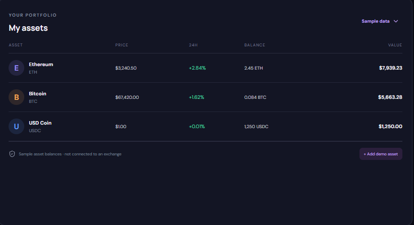
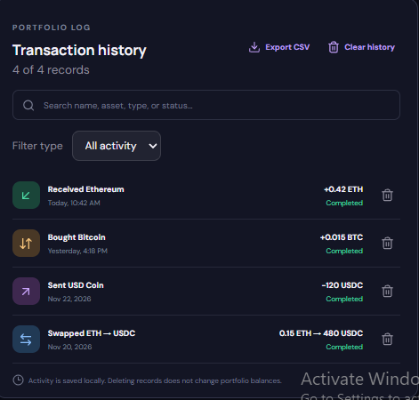

# WalletFlow

### A modern Web3 portfolio dashboard built with React, TypeScript, and Vite.

WalletFlow is a responsive fintech-inspired cryptocurrency portfolio dashboard designed to explore digital asset holdings, visualize portfolio analytics, manage simulated transactions, and connect a browser wallet in read-only mode.

<p align="center">
  <a href="https://wallet-flow-lovat.vercel.app/">
    <strong>🌐 Live Demo</strong>
  </a>
</p>

---

## Preview

### Dashboard


### My Assets


### Transaction History


### Wallet Connection


---

## Features

### Portfolio Dashboard
- Dark, responsive fintech-inspired interface.
- Portfolio value and asset allocation overview.
- Interactive portfolio chart with selectable display ranges.
- Balance visibility toggle.
- Overview of assets, activity, and wallet status.

### Asset Management
- Demonstration holdings for Ethereum (ETH), Bitcoin (BTC), and USD Coin (USDC).
- Asset prices and portfolio valuation using illustrative data.
- Locally persisted demo portfolio changes.

### Transaction Management
- Simulated Send, Receive, Swap, and Buy actions.
- Transaction history with search and filtering.
- Delete individual demo transaction records.
- Clear transaction history.
- Export transaction history as CSV.
- Local browser persistence for supported demo records.

### Wallet Connectivity
- Optional connection to an injected browser wallet provider, such as MetaMask.
- Account access request through the wallet provider.
- Native ETH balance retrieval.
- Account and network change event handling.
- Wallet connection status and error handling.
- No transaction signing or blockchain transaction execution.

### User Experience
- Responsive sidebar navigation.
- Mobile-friendly layouts.
- Toast notifications.
- Input validation and error handling.
- Local storage persistence.

---

## Tech Stack

| Technology | Purpose |
|---|---|
| React | User interface |
| TypeScript | Type safety |
| Vite | Development and build tooling |
| CSS | Styling and responsive layouts |
| Recharts | Portfolio charts |
| ethers.js | Wallet and blockchain data interaction |
| Lucide React | Icons |
| localStorage | Local demo data persistence |
| MetaMask | Example injected browser wallet provider |

---

## Documentation

WalletFlow includes technical documentation covering its architecture, data flows, engineering decisions, testing process, developer setup, and implementation.

| Document | Description |
|---|---|
| [Architecture](docs/architecture.md) | Application structure, logical layers, and system architecture |
| [Data Flow](docs/data-flow.md) | Portfolio, transaction, and wallet data flows |
| [Technical Decisions](docs/technical-decisions.md) | Technology choices, trade-offs, and design decisions |
| [Testing & Quality Assurance](docs/testing.md) | Verification commands, testing scope, and manual checklist |
| [Developer Guide](docs/developer-guide.md) | Installation, development workflow, and contribution guidelines |
| [Engineering Case Study](docs/engineering-case-study.md) | Detailed report covering architecture, implementation, testing, security, and deployment |

---

## Getting Started

### Requirements

- Node.js 20 LTS recommended
- npm
- Git

### Installation

**1. Clone the repository**

```bash
git clone https://github.com/stolencenturies/WalletFlow.git
```

**2. Navigate into the project directory**

```bash
cd WalletFlow
```

**3. Install dependencies**

```bash
npm install
```

**4. Start the development server**

```bash
npm run dev
```

Open the local URL provided by Vite, usually:

```text
http://localhost:5173
```

---

## Available Scripts

| Command | Description |
|---|---|
| `npm run dev` | Start the development server |
| `npm run lint` | Run ESLint checks |
| `npm run build` | Run TypeScript project build and create the Vite production build |
| `npm run preview` | Preview the production build locally |

### Production Verification

```bash
npm run lint
npm run build
npm run preview
```

---

## Project Structure

```text
WalletFlow/
├── public/
│   └── images/
│       ├── dashboard.png
│       ├── assets.png
│       ├── transactions.png
│       └── wallet-connection.png
├── docs/
│   ├── architecture.md
│   ├── data-flow.md
│   ├── technical-decisions.md
│   ├── testing.md
│   ├── developer-guide.md
│   └── engineering-case-study.md
├── src/
│   ├── App.tsx
│   ├── App.css
│   ├── data.ts
│   ├── index.css
│   ├── main.tsx
│   ├── types.ts
│   └── vite-env.d.ts
├── .gitignore
├── eslint.config.js
├── index.html
├── package.json
├── package-lock.json
├── tsconfig.app.json
├── tsconfig.json
├── tsconfig.node.json
└── vite.config.ts
```

---

## Deployment

WalletFlow is deployed on Vercel.

**Live Application:**  
https://wallet-flow-lovat.vercel.app/

**GitHub Repository:**  
https://github.com/stolencenturies/WalletFlow

The repository is connected to Vercel for deployment when changes are pushed to the configured production branch.

---

## Important Disclaimer

WalletFlow is an educational frontend portfolio project, not a production cryptocurrency wallet or financial service.

- Portfolio prices and chart values are illustrative demo data.
- The portfolio chart does not represent verified historical market performance.
- Send, Receive, Swap, and Buy actions are simulations.
- Demo transactions do not transfer actual funds.
- The optional wallet integration retrieves selected account and network information through a browser wallet provider.
- Connecting a wallet may require the user to approve account access.
- The application does not request transaction signatures or execute blockchain transactions.
- Demo portfolio records are stored locally in the browser.

Never send cryptocurrency to placeholder addresses displayed by the application.

---

## Future Improvements

Potential areas for future development:

- Expanded portfolio analytics.
- Live market data integration.
- More detailed asset information.
- Improved accessibility.
- Automated testing.
- More comprehensive wallet-provider testing.
- Further performance optimization.

---

## License

This project is provided for educational and portfolio demonstration purposes.
