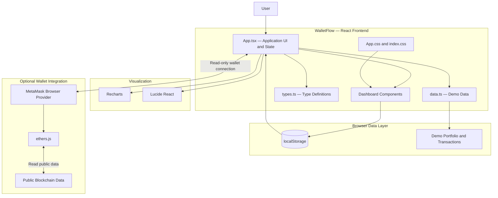
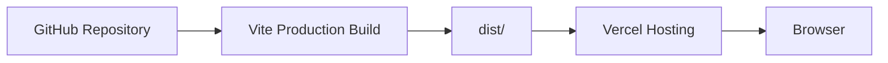

# WalletFlow — System Architecture

## 1. Architecture Overview

WalletFlow is a client-side React application built with TypeScript and Vite.

It combines local demo portfolio data, browser-based persistence, interactive visualizations, and optional read-only MetaMask connectivity.

## 2. High-Level Architecture

## 3. Main Application Layers

### Presentation Layer

**Main file:** `src/App.tsx`

Responsible for the main application interface, dashboard experience, and interaction with the user.

Supporting files:

- `src/App.css`
- `src/index.css`

These files provide the visual styling and responsive layout.

### Data and Type Layer

**Main files:**

- `src/data.ts`
- `src/types.ts`

The data module provides sample application data.

The types module defines TypeScript structures used throughout the application.

### Browser Persistence

WalletFlow uses browser `localStorage` for demo portfolio and transaction records.

This allows demo information to remain available after refreshing the page in the same browser.

It does not create a remote database or synchronize records across devices.

### Visualization Layer

**Library:** Recharts

Used to display portfolio performance and other chart-based information.

**Library:** Lucide React

Used for interface icons.

### Wallet Integration Layer

**Libraries:** MetaMask and ethers.js

The optional wallet integration communicates with the browser wallet provider to access public wallet information, including the native ETH balance.

WalletFlow uses read-only access. It does not request transaction signatures or execute blockchain transactions.

## 4. Application Data Flow

### Demo Portfolio Flow

1. The application initializes its demo portfolio data.
2. Portfolio information is displayed in the dashboard.
3. User interactions can update demo records.
4. Relevant demo data is persisted in localStorage.
5. Saved records can be restored when the application loads again.

### Transaction Flow

1. The user performs a simulated transaction action.
2. The application creates a demo transaction record.
3. The transaction history is updated.
4. The updated records are persisted locally.
5. The user can search, filter, delete, clear, or export transaction history.

### Wallet Connection Flow

1. The user selects Connect Wallet.
2. The application checks for an available browser wallet provider.
3. MetaMask provides wallet access.
4. ethers.js is used to interact with the provider.
5. Public wallet information and native balance are displayed.
6. Account and network changes are synchronized with the interface.

No transaction signing or fund transfers take place.

## 5. Technology Responsibilities

| Technology | Responsibility |
|---|---|
| React | Component-based user interface |
| TypeScript | Static typing |
| Vite | Development and production build tooling |
| CSS | Styling and responsive design |
| Recharts | Data visualization |
| ethers.js | Blockchain provider interaction |
| MetaMask | Optional browser wallet provider |
| Lucide React | Interface icons |
| localStorage | Browser-side demo persistence |

## 6. Production Architecture

GitHub stores the project source code.

Vite builds the production application into the `dist/` directory.

Vercel hosts the generated production application and supports automated deployments from the connected GitHub repository.

## 7. Important Architectural Limitations

- WalletFlow is a frontend portfolio demonstration.
- Portfolio prices and performance data are illustrative.
- Demo transactions do not represent blockchain transactions.
- Demo records are stored in the browser, not a backend database.
- Wallet connectivity is optional and read-only.
- The application does not execute financial transactions.

---

**Project:** WalletFlow  
**Frontend:** React + TypeScript + Vite  
**Deployment:** Vercel  
**Repository:** GitHub
