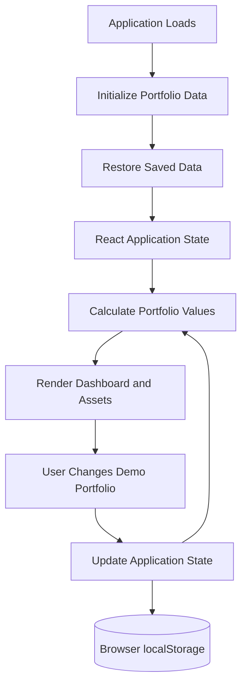
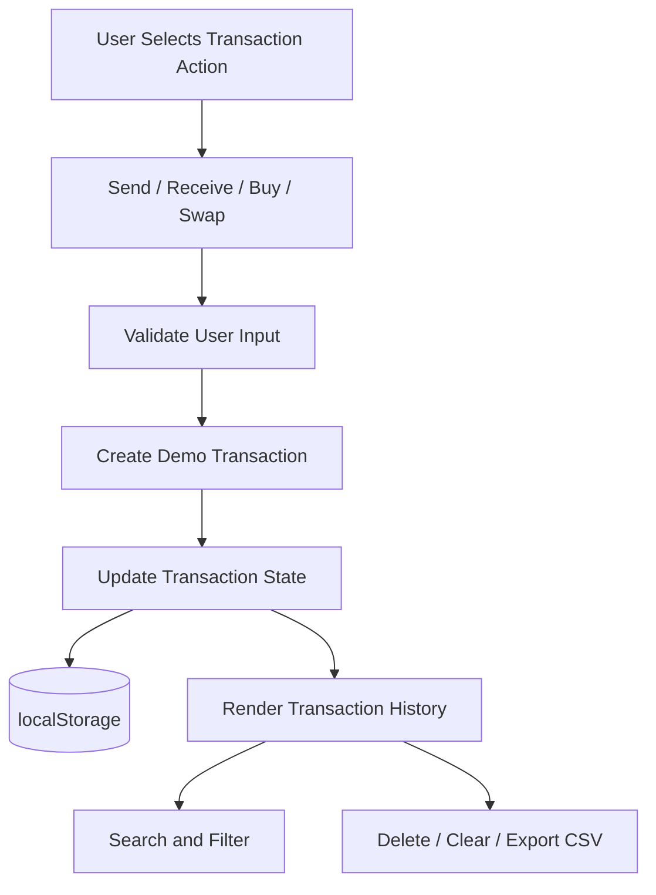
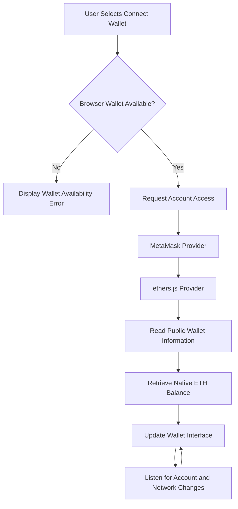

# WalletFlow — Data Flow Documentation

## 1. Overview

WalletFlow uses two primary sources of information:

1. Local demo data managed by the React application.
2. Public wallet information retrieved through an optional read-only browser wallet connection.

The application displays this information through its dashboard, asset list, transaction history, and portfolio visualizations.

---

## 2. Demo Portfolio Data Flow

The demo portfolio is managed by the frontend.

### Explanation

1. The application initializes its portfolio information.
2. Previously saved demo information can be restored from browser storage.
3. React manages the information displayed by the interface.
4. Portfolio values are calculated from the available demo balances and prices.
5. Changes to demo portfolio information update the application.
6. Relevant changes are persisted in localStorage.

This allows demo information to survive a browser refresh.

---

## 3. Transaction Data Flow

WalletFlow supports simulated transaction actions.

### Explanation

1. The user selects a simulated transaction action.
2. The application processes the entered information.
3. Input validation checks the transaction details.
4. A demo transaction record is created.
5. The transaction history is updated.
6. Relevant transaction information is saved locally.
7. The user can search, filter, delete, clear, or export records.

**Important:** These actions only manage local demo records. They do not transfer cryptocurrency or modify blockchain balances.

---

## 4. Wallet Connection Data Flow

WalletFlow optionally connects to MetaMask through the browser wallet provider.

### Explanation

1. The user chooses to connect a browser wallet.
2. The application checks whether a compatible wallet provider is available.
3. The user authorizes account access through MetaMask.
4. ethers.js communicates with the wallet provider.
5. Public wallet information is retrieved.
6. The native ETH balance is read.
7. The dashboard displays the wallet connection information.
8. Account and network changes are synchronized with the interface.

The wallet integration is read-only. It does not request transaction signatures or execute transfers.

---

## 5. Data Source Comparison

| Information | Source | Persistence |
|---|---|---|
| Demo asset holdings | Application demo data | Browser storage |
| Illustrative asset prices | Demo data | Application data |
| Demo transactions | User-generated demo records | Browser storage |
| Portfolio chart | Illustrative portfolio data | Application data |
| Wallet address | Connected browser wallet | Wallet provider |
| Native ETH balance | Public blockchain data through provider | Retrieved when needed |
| Wallet network | Connected wallet provider | Retrieved when needed |

---

## 6. Browser Storage

WalletFlow uses localStorage to persist demo information.

### Characteristics

- Data remains available after refreshing the browser.
- Storage belongs to the current browser and origin.
- Different browsers do not automatically share the same records.
- Clearing browser storage can remove saved demo information.
- localStorage is not a remote database or cloud synchronization service.

### Important distinction

Demo portfolio records and blockchain wallet information are separate.

Changing a demo asset balance does not change a real wallet balance.

---

## 7. Security and Data Boundaries

WalletFlow is designed as an educational frontend demonstration.

Important boundaries:

- No real cryptocurrency transfers.
- No transaction signing.
- No private-key management.
- No recovery phrase collection.
- No backend financial database.
- No real payment processing.

The optional wallet connection is used to read publicly available wallet information.

---

## 8. Summary

WalletFlow combines React application state, browser localStorage, illustrative portfolio data, and optional read-only wallet connectivity.

Its data flow separates simulated portfolio management from real public blockchain information.

This separation is central to understanding the application's functionality and limitations.
