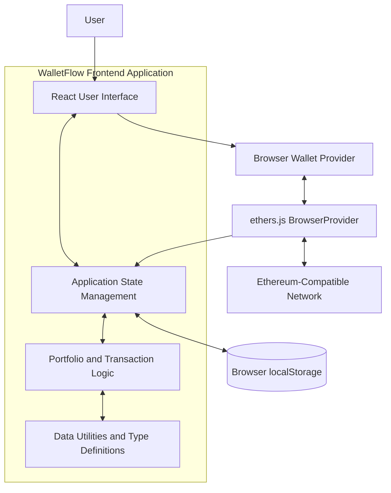
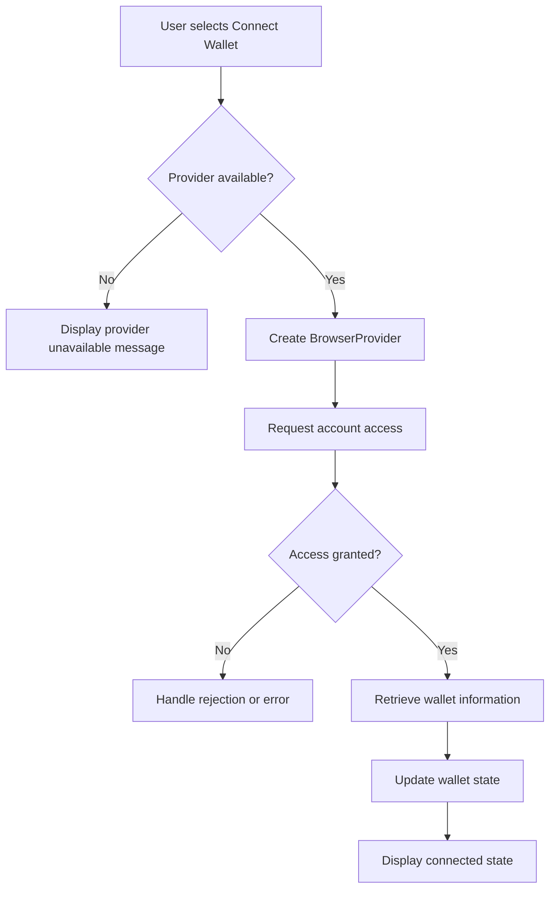
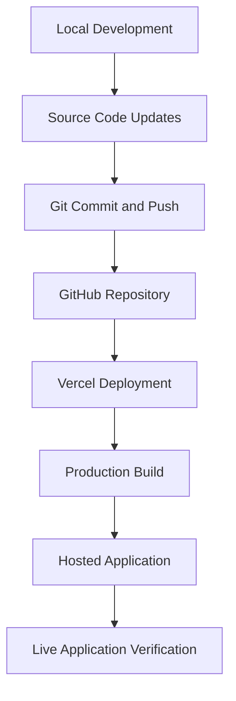
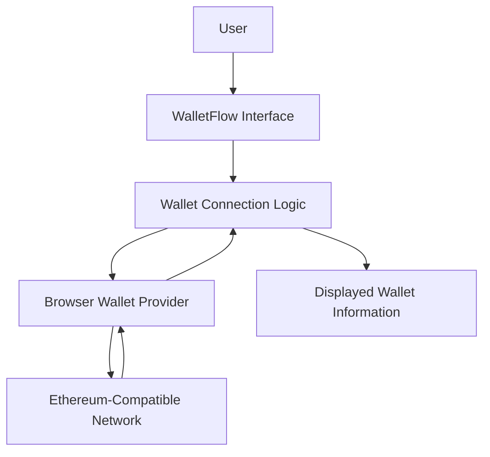
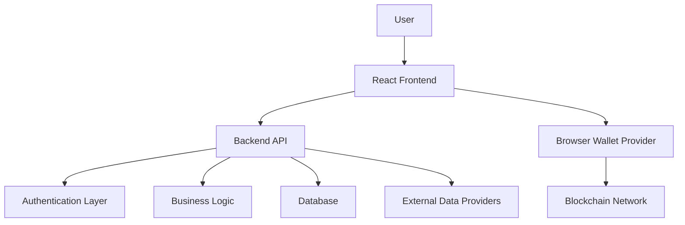

# WalletFlow: Engineering a Read-Only Web3 Portfolio Dashboard

## An Engineering Case Study

**Author:** Sayan Dhar

**Project:** WalletFlow

**Repository:** https://github.com/stolencenturies/WalletFlow

**Live Application:** https://wallet-flow-lovat.vercel.app/

**Technology Stack:** React, TypeScript, Vite, CSS, Recharts, ethers.js

**Document Type:** Software Engineering Case Study

---

## Abstract

WalletFlow is a frontend-focused Web3 portfolio dashboard developed using React, TypeScript, and Vite. The application provides a cryptocurrency portfolio interface featuring asset visualization, interactive portfolio analytics, simulated transaction management, browser-based data persistence, and optional read-only MetaMask connectivity.

This engineering case study documents the design and implementation approach behind WalletFlow. It examines the application's frontend architecture, technology selection, state management, local persistence, wallet-provider integration, validation, testing practices, and production deployment.

A central design consideration is the separation of portfolio simulation from blockchain interaction. While users can explore simulated financial operations within the application, wallet connectivity is intended for reading publicly available account and network information rather than authorizing or executing transactions.

The report also discusses architectural trade-offs, implementation limitations, and lessons that developers can apply when building similar frontend applications.

**Keywords:** Web3, React, TypeScript, Ethereum, MetaMask, Frontend Engineering, State Management, Software Architecture.

---

## 1. Introduction

### 1.1 Background

Web3 applications frequently combine conventional frontend interfaces with blockchain-related data and wallet-provider integrations.

Building such applications requires more than presenting financial information visually. Developers must consider application architecture, state management, data consistency, user interaction, provider connectivity, error handling, and the distinction between simulated and actual blockchain operations.

WalletFlow was developed as an educational engineering project to explore these concerns within a single frontend application.

### 1.2 Project Objective

The primary objective was to develop a responsive cryptocurrency portfolio dashboard that demonstrates:

- Component-based frontend development.
- Type-safe application logic.
- Portfolio visualization.
- Simulated transaction management.
- Persistent browser-based application state.
- Read-only browser wallet connectivity.
- Production build and deployment workflows.

### 1.3 Scope

WalletFlow is a frontend application.

Its implemented scope includes portfolio visualization, illustrative asset data, simulated transaction operations, local browser persistence, and read-only wallet information retrieval.

It does not provide real cryptocurrency custody, financial services, or transaction execution.

### 1.4 Engineering Focus

This case study focuses on five engineering areas:

1. Frontend application architecture.
2. State management and persistence.
3. Browser wallet-provider integration.
4. Application validation and reliability.
5. Production readiness and deployment.

The objective is to explain not only what was implemented, but also why particular engineering approaches were selected.


---

## 2. Problem Definition and Software Requirements

### 2.1 Problem Statement

A cryptocurrency portfolio dashboard must present financial information in a way that is understandable, responsive, and easy to interact with.

However, developing such an interface introduces several engineering challenges:

- Presenting multiple digital assets within a unified dashboard.
- Communicating portfolio information through visual analytics.
- Managing user interactions and transaction records.
- Maintaining application state across browser sessions.
- Integrating with browser wallet providers.
- Handling account changes, network changes, and provider errors.
- Maintaining a clear distinction between simulated operations and actual blockchain transactions.

WalletFlow addresses these challenges through a frontend-oriented application architecture.

The project demonstrates how a modern web application can combine portfolio visualization, local state management, and read-only blockchain connectivity without implementing cryptocurrency custody or transaction execution.

### 2.2 Project Goals

The primary goals established for WalletFlow were:

| Goal | Description |
|---|---|
| Portfolio visualization | Present portfolio value, asset allocation, and performance information |
| Asset representation | Display cryptocurrency holdings using illustrative data |
| Transaction interaction | Provide simulated Send, Receive, Swap, and Buy operations |
| Data persistence | Preserve supported demo application records using browser storage |
| Wallet connectivity | Retrieve publicly available wallet information through MetaMask |
| Responsive interface | Support desktop and mobile layouts |
| Reliability | Include validation, error handling, and application-state management |
| Deployment | Build and publish the application for public access |

### 2.3 Functional Requirements

Functional requirements describe what the application should do.

The following table documents the principal capabilities implemented in WalletFlow.

| ID | Requirement | Implementation |
|---|---|---|
| FR-01 | Display portfolio information | Dashboard overview |
| FR-02 | Display supported asset holdings | ETH, BTC, and USDC demo assets |
| FR-03 | Visualize portfolio performance | Interactive Recharts visualization |
| FR-04 | Support selectable chart ranges | Portfolio chart range controls |
| FR-05 | Allow balance visibility control | Balance visibility toggle |
| FR-06 | Simulate financial operations | Send, Receive, Swap, and Buy interfaces |
| FR-07 | Display transaction records | Transaction history |
| FR-08 | Search and filter transactions | Transaction history controls |
| FR-09 | Delete transaction records | Individual deletion and history clearing |
| FR-10 | Export transaction history | CSV export |
| FR-11 | Persist supported demo records | Browser localStorage |
| FR-12 | Connect to a browser wallet | Optional MetaMask integration |
| FR-13 | Retrieve wallet information | Read-only account and native ETH balance retrieval |
| FR-14 | Respond to wallet changes | Account and network event synchronization |
| FR-15 | Provide user feedback | Toast notifications and error handling |

These requirements describe the implemented frontend functionality. They do not imply that simulated financial operations execute on a blockchain.

### 2.4 Non-Functional Requirements

Non-functional requirements describe the expected quality and operational characteristics of the application.

#### 2.4.1 Usability

The interface should present portfolio information clearly and make important actions accessible.

The design uses a dashboard-oriented layout, visual hierarchy, navigation controls, and feedback notifications.

#### 2.4.2 Responsiveness

The application should remain usable across different screen sizes.

Responsive layouts and mobile navigation are included to support smaller displays.

#### 2.4.3 Maintainability

The application uses React and TypeScript to support component-based development and more predictable application logic.

Descriptive component responsibilities and typed application data help make future modifications easier to manage.

#### 2.4.4 Reliability

The application should handle invalid input and unexpected wallet-provider conditions without presenting every operation as successful.

Input validation, error handling, and user notifications are used to improve interaction reliability.

#### 2.4.5 Data Persistence

Supported demo records should remain available across browser sessions through localStorage.

This persistence is browser-specific and should not be interpreted as cloud synchronization or centralized database storage.

#### 2.4.6 Security Boundaries

Wallet connectivity is designed around read-only information retrieval.

The application does not request private keys or seed phrases, does not request transaction signatures, and does not execute blockchain transactions.

### 2.5 System Constraints and Assumptions

WalletFlow was developed with several deliberate constraints.

| Constraint | Engineering implication |
|---|---|
| Frontend-only architecture | No application backend or centralized database is provided |
| Illustrative portfolio data | Displayed portfolio prices are not live financial market quotations |
| Simulated transactions | Transaction operations do not transfer actual funds |
| Browser storage | Demo records are stored locally on the user's device |
| Optional wallet provider | Wallet connectivity depends on a compatible browser wallet |
| Read-only wallet access | Blockchain interaction is limited to retrieving publicly available information |

These constraints establish the boundaries of the project and prevent the demonstration interface from being confused with a production cryptocurrency wallet.

### 2.6 Success Criteria

The project was considered ready for its portfolio demonstration when the following conditions were met:

1. The application could be started locally using the Vite development server.
2. The production build completed successfully.
3. ESLint checks passed.
4. The main dashboard and asset views rendered correctly.
5. Portfolio chart interactions worked.
6. Simulated transaction interfaces and transaction history behaved as expected.
7. Supported demo records persisted across browser sessions.
8. CSV export functionality was available.
9. Responsive layouts were reviewed.
10. The application was deployed and accessible through its public Vercel URL.

These criteria describe the project's completed verification activities. They are not claims of formal security certification, automated test coverage, or production financial validation.

### 2.7 Scope Boundaries

It is important to distinguish the capabilities of the current application from features that would require additional engineering work.

**Included in the current implementation:**

- Frontend portfolio dashboard.
- Illustrative cryptocurrency holdings.
- Portfolio chart visualization.
- Simulated transaction management.
- Browser-based persistence.
- Read-only MetaMask connectivity.
- Production frontend deployment.

**Outside the current implementation:**

- Real cryptocurrency transfers.
- Transaction signing.
- Private-key management.
- Cryptocurrency custody.
- Backend user authentication.
- Centralized database synchronization.
- Verified live market-price infrastructure.
- Production financial transaction processing.

### 2.8 Requirements Summary

WalletFlow demonstrates how a frontend application can provide a cohesive portfolio experience while maintaining clear technical boundaries.

The requirements prioritize usability, maintainability, responsive design, local persistence, and controlled wallet connectivity.

By defining these requirements before examining the implementation, the engineering decisions discussed in subsequent chapters can be evaluated against the original project objectives.


---

## 3. System Architecture

### 3.1 Architectural Overview

WalletFlow follows a frontend-oriented, client-side application architecture built around React and TypeScript.

The application combines user-interface rendering, application state management, portfolio calculations, browser storage, and optional blockchain-provider interaction.

Its architecture can be understood through five logical areas:

1. Presentation layer
2. Application logic and state management
3. Portfolio data and utility layer
4. Browser persistence layer
5. External wallet-provider integration

These are logical architectural responsibilities rather than five independently deployed services or separate application modules.

### 3.2 High-Level Architecture

The following diagram illustrates the relationship between the major parts of the application.



The diagram represents the logical flow of information. It does not imply that every application interaction requires communication with an external blockchain network.

### 3.3 Presentation Layer

The presentation layer is responsible for rendering the dashboard and providing user interaction.

WalletFlow uses React to render the interface and manage interactive application elements.

The interface includes:

- Portfolio overview.
- Asset holdings.
- Portfolio performance chart.
- Wallet connection panel.
- Transaction history.
- Search and filtering controls.
- Simulated transaction interfaces.
- Responsive navigation.
- Toast notifications.

Recharts is used to render the portfolio visualization, while Lucide React provides interface icons.

CSS controls the application's visual presentation and responsive layout.

The presentation layer communicates with application state through React event handlers and state updates.

### 3.4 Application Logic and State Management

The application logic is primarily implemented within `App.tsx`.

React hooks are used to manage state, derive calculated values, and synchronize application behavior.

The principal hooks include:

| Hook | Responsibility |
|---|---|
| useState | Stores assets, transactions, wallet information, interface state, and user input |
| useEffect | Synchronizes browser persistence and wallet-provider event listeners |
| useMemo | Calculates derived portfolio values and chart data |
| useCallback | Maintains a stable wallet-refresh function |

The application maintains several categories of state:

**Portfolio state**
- Asset holdings.
- Transaction records.

**Interface state**
- Active navigation state.
- Chart range.
- Balance visibility.
- Transaction search and filters.
- Active demo action.
- Toast notifications.

**Wallet state**
- Connected account information.
- Network identifier.
- Native ETH balance.
- Loading and error states.

Derived portfolio information is calculated from the underlying asset data rather than being treated as an independent source of truth.

For example, total portfolio value is calculated by combining the value of individual holdings.

### 3.5 Portfolio Data and Utility Layer

The `data.ts` file provides supporting portfolio data and utility functions.

The application imports functionality including:

- `initialAssets`
- `initialTransactions`
- `assetValue`
- `formatBalance`
- `formatUSD`
- `getChartData`

These utilities support portfolio initialization, asset valuation, display formatting, and chart-data generation.

The `types.ts` file provides TypeScript definitions for important application data structures, including:

- `Asset`
- `Transaction`
- `WalletState`

These definitions help maintain consistency when portfolio information and wallet state are accessed throughout the application.

### 3.6 Browser Persistence Layer

WalletFlow uses the browser's localStorage API to preserve supported demo portfolio information.

The application defines a storage key:

`walletflow:portfolio:v1`

The persistence workflow consists of two main operations.

**Loading application data**

During initialization, the application attempts to retrieve saved portfolio information.

The retrieved JSON is parsed and checked for the expected asset and transaction arrays.

If valid saved data is unavailable, the application falls back to its initial sample assets and transactions.

**Saving application data**

A React effect monitors changes to the asset and transaction state.

When either changes, the updated portfolio is serialized using JSON and stored in localStorage.

This allows supported demo records to remain available after a browser refresh.

The storage mechanism is local to the browser and does not provide centralized synchronization between devices.

### 3.7 External Wallet Integration

WalletFlow optionally connects to a browser wallet through an injected Ethereum provider.

The integration uses ethers.js and its `BrowserProvider` abstraction.

The general interaction flow is:

1. Check whether a browser wallet provider is available.
2. Request account access when the user initiates connection.
3. Retrieve the selected account.
4. Retrieve the current network information.
5. Request the account's native ETH balance.
6. Format the balance for presentation.
7. Update the application's wallet state.

The application also listens for account and network changes.

The relevant provider events include:

- `accountsChanged`
- `chainChanged`

When these events occur, the application refreshes or clears the displayed wallet state as appropriate.

The wallet integration is designed for read-only information retrieval. It does not implement transaction signing or blockchain transaction execution.

### 3.8 Technology Responsibilities

| Technology | Architectural Responsibility |
|---|---|
| React | Interface rendering and state management |
| TypeScript | Type definitions and safer application logic |
| Vite | Development server and production build tooling |
| CSS | Layout, visual presentation, and responsive behavior |
| Recharts | Portfolio chart visualization |
| ethers.js | Browser wallet-provider interaction and blockchain data retrieval |
| Lucide React | Interface iconography |
| localStorage | Local demo portfolio persistence |
| MetaMask | Optional injected browser wallet provider |

### 3.9 Architectural Data Flow

The application's major data flows can be summarized in three categories.

**Portfolio flow**

Initial portfolio data or previously saved browser data is loaded into React state.

Portfolio calculations derive total value and chart information from the current asset state.

Changes to supported demo holdings update application state and are persisted through localStorage.

**Transaction flow**

User interactions initiate simulated transaction operations.

The application validates the input, updates the relevant demo portfolio state, and records an activity entry.

The updated records are subsequently persisted in browser storage.

**Wallet flow**

The user initiates wallet connection through the interface.

The application communicates with the injected browser provider through ethers.js, retrieves public account information, and updates wallet state.

Provider events keep the displayed wallet information synchronized with account and network changes.

### 3.10 Architectural Trade-offs

The frontend-first architecture offers several advantages for an educational project.

**Advantages**

- Straightforward deployment.
- No backend infrastructure required.
- Direct integration with browser wallet providers.
- Simple local persistence.
- Relatively low operational complexity.
- A focused environment for learning frontend and Web3 integration.

**Limitations**

- No centralized database.
- No cross-device portfolio synchronization.
- Limited separation of application responsibilities.
- Portfolio sample data is not a verified live market-data service.
- Client-side storage is not suitable as a secure financial record system.

The current implementation keeps substantial application logic in `App.tsx`. For a larger production application, separating UI components, domain logic, persistence utilities, and wallet integration into dedicated modules could improve maintainability and testability.

### 3.11 Architecture Summary

WalletFlow demonstrates a client-side architecture that combines React-based interface rendering, TypeScript application logic, browser persistence, and optional wallet-provider interaction.

Its design prioritizes simplicity, transparency, and a clearly defined separation between simulated portfolio functionality and read-only blockchain information retrieval.

The architecture provides a foundation for understanding how a frontend Web3 dashboard can be structured while identifying the additional engineering work required to evolve it into a larger application.
```


## 4. Technology Selection and Engineering Trade-offs

### 4.1 Introduction

Selecting an appropriate technology stack is an important part of software engineering.

Technology decisions influence application performance, maintainability, development complexity, scalability, and the ability to introduce new features.

WalletFlow uses a frontend-focused technology stack consisting of React, TypeScript, Vite, CSS, Recharts, ethers.js, Lucide React, and browser localStorage.

This chapter examines the responsibilities of these technologies, the engineering rationale for using them, and the trade-offs associated with the selected approach.

### 4.2 React — User Interface and State Management

**Role:** Frontend application framework.

React provides the foundation for rendering the WalletFlow interface and managing interactive application state.

Its component-based approach allows interface elements to be represented through reusable UI structures.

React hooks are used to manage application state, synchronize effects, calculate derived values, and maintain callback behavior.

**Engineering rationale:**

- Supports interactive user interfaces.
- Provides declarative rendering.
- Offers state-management capabilities through hooks.
- Has a large ecosystem of libraries and development resources.
- Supports incremental application development.

**Trade-offs:**

React introduces additional concepts such as component lifecycle behavior, state synchronization, and effect management.

For a small application, a simpler JavaScript implementation might require less initial setup. However, React provides a useful foundation for applications with multiple interactive views and changing application state.

### 4.3 TypeScript — Type-Safe Application Logic

**Role:** Static type checking and application data modeling.

TypeScript extends JavaScript with a type system that helps developers identify certain classes of programming errors during development.

WalletFlow uses TypeScript definitions for important application structures, including assets, transactions, and wallet state.

**Engineering rationale:**

- Makes data structures more explicit.
- Helps identify incompatible values during development.
- Improves editor support and code navigation.
- Makes application interfaces easier to understand.
- Supports safer refactoring.

**Trade-offs:**

TypeScript introduces additional type definitions and configuration.

It also requires developers to understand interfaces, unions, generics, and type narrowing as application complexity increases.

TypeScript does not automatically validate external runtime data. Data received from browser storage or external providers still requires appropriate runtime checks.

### 4.4 Vite — Development and Build Tooling

**Role:** Frontend development server and production build tooling.

Vite provides the development environment and production build process used by WalletFlow.

It supports a fast development workflow and generates optimized production assets.

**Engineering rationale:**

- Provides a lightweight development setup.
- Supports modern JavaScript and TypeScript workflows.
- Offers a development server with hot module replacement.
- Provides production build functionality.
- Integrates with the React ecosystem.

**Trade-offs:**

Vite is focused on frontend development and build tooling.

It does not independently provide backend services, authentication infrastructure, database functionality, or application hosting.

These capabilities require separate infrastructure when a project needs them.

### 4.5 CSS — Visual Presentation and Responsive Design

**Role:** Application styling and layout.

CSS is responsible for the visual presentation of WalletFlow.

It controls layout, spacing, typography, colors, component appearance, and responsive behavior.

**Engineering rationale:**

- Provides direct control over visual presentation.
- Supports responsive layouts.
- Does not require an additional styling framework.
- Allows the interface to maintain a consistent visual design.

**Trade-offs:**

As an application grows, maintaining consistent styling can become more difficult without clear naming conventions and reusable design patterns.

A larger project could benefit from a design-token system, CSS modules, or another organized styling approach.

### 4.6 Recharts — Portfolio Visualization

**Role:** Data visualization.

Recharts is used to display portfolio performance information through interactive charts.

The library integrates with React and provides chart components that can represent application data visually.

**Engineering rationale:**

- Provides reusable chart components.
- Integrates with React.
- Supports interactive data visualization.
- Reduces the need to implement chart rendering from scratch.

**Trade-offs:**

A charting library introduces an external dependency and its own API.

The accuracy of a chart still depends on the quality and meaning of the underlying data.

In WalletFlow, portfolio chart information is illustrative rather than verified historical market performance.

### 4.7 ethers.js — Blockchain Provider Interaction

**Role:** Ethereum-compatible blockchain data interaction.

WalletFlow uses ethers.js to communicate with the browser wallet provider.

The `BrowserProvider` abstraction is used to interact with an injected Ethereum provider.

The application retrieves publicly available account and network information, including the native ETH balance.

**Engineering rationale:**

- Provides abstractions for Ethereum provider interaction.
- Simplifies access to blockchain-related information.
- Supports browser wallet integration.
- Provides utilities for formatting blockchain values.

**Trade-offs:**

Blockchain interaction introduces external dependencies.

Wallet availability, network connectivity, account permissions, and provider behavior can affect application functionality.

The library does not remove the need for careful error handling or security boundaries.

WalletFlow uses ethers.js for read-only information retrieval and does not implement transaction signing or execution.

### 4.8 Lucide React — Interface Icons

**Role:** Iconography and visual communication.

Lucide React provides the icons used throughout the application.

**Engineering rationale:**

- Provides a consistent icon style.
- Integrates with React components.
- Avoids manually maintaining large collections of icon assets.
- Supports a consistent visual language across the interface.

**Trade-offs:**

An icon library introduces an additional dependency.

Developers must also ensure that icons have appropriate labels or accessible descriptions when necessary.

### 4.9 localStorage — Browser-Based Persistence

**Role:** Local application data persistence.

WalletFlow uses the browser's localStorage API to preserve supported demo portfolio records.

Data is serialized into JSON before storage and parsed when the application initializes.

**Engineering rationale:**

- Requires no backend infrastructure.
- Is available directly in modern browsers.
- Provides persistence across page reloads.
- Is suitable for a small frontend demonstration.

**Trade-offs:**

localStorage is specific to a browser and origin.

It does not provide:

- Cross-device synchronization.
- Centralized user accounts.
- Database transactions.
- Server-side validation.
- Secure storage for sensitive financial information.

For a production application, a backend service and a properly designed persistence architecture would be necessary for centralized data management.

### 4.10 MetaMask — Browser Wallet Provider

**Role:** Optional browser wallet connectivity.

MetaMask provides an injected browser wallet provider through which compatible web applications can request account access and retrieve blockchain information.

WalletFlow uses this integration to display publicly available wallet information.

**Engineering rationale:**

- Demonstrates interaction with an external browser provider.
- Allows users to connect an existing wallet.
- Supports account and network change notifications.
- Provides a practical introduction to Web3 frontend development.

**Trade-offs:**

The application depends on the availability and behavior of an external browser wallet.

Users may not have a compatible wallet installed, may reject account access, or may change accounts and networks during a session.

The application must therefore handle unavailable providers, permission states, and provider events.

### 4.11 Technology Comparison

The following table summarizes the selected technologies and their architectural alternatives.

| Responsibility | Selected Technology | Possible Alternatives |
|---|---|---|
| User interface | React | Vue, Angular, Svelte |
| Type system | TypeScript | JavaScript |
| Build tooling | Vite | Webpack-based tooling |
| Styling | CSS | Tailwind CSS, CSS Modules |
| Chart visualization | Recharts | Chart.js, D3.js |
| Ethereum interaction | ethers.js | viem, web3.js |
| Iconography | Lucide React | React Icons |
| Local persistence | localStorage | IndexedDB, backend database |
| Wallet provider | MetaMask | Other EIP-1193-compatible wallets |

The alternatives are examples of technologies that could be evaluated for similar projects. They were not necessarily implemented or benchmarked against WalletFlow.

### 4.12 Overall Engineering Trade-offs

The selected stack prioritizes a relatively simple frontend architecture with established tools.

The combination of React and TypeScript provides an interactive and typed application foundation.

Vite supports the development and production build workflow, while Recharts and ethers.js provide specialized functionality for visualization and blockchain interaction.

CSS and localStorage keep the implementation relatively lightweight by avoiding additional styling infrastructure and backend persistence services.

The primary trade-off is that this simplicity limits the application's suitability for production financial operations, centralized data management, and larger multi-user systems.

### 4.13 Lessons for Engineering Teams

The technology decisions in WalletFlow demonstrate several principles that can be applied to other software projects:

1. Select technologies based on actual product requirements.
2. Avoid introducing infrastructure that the current scope does not require.
3. Understand the limitations of browser-based storage.
4. Treat external providers as unreliable dependencies that require error handling.
5. Use type systems to make application data structures more explicit.
6. Keep the distinction between demonstration functionality and production functionality clear.
7. Evaluate alternative technologies based on maintainability, complexity, and project requirements.

### 4.14 Chapter Summary

WalletFlow demonstrates how a modern frontend technology stack can be combined to build an interactive Web3 portfolio dashboard.

Each selected technology addresses a specific engineering responsibility.

The resulting architecture provides a practical foundation for exploring frontend engineering, browser persistence, data visualization, and blockchain-provider integration.

The next chapter examines how these technologies work together during the actual implementation of the application's major features.


---

## 5. Implementation: From Architecture to Working Product

### 5.1 Introduction

The implementation of WalletFlow translates the requirements established in Chapter 2 into a working frontend application.

The project combines React, TypeScript, Vite, CSS, Recharts, ethers.js, and browser localStorage to deliver an interactive cryptocurrency portfolio dashboard.

The implementation follows a client-side approach, with application state managed through React and supporting functionality provided by dedicated libraries and browser APIs.

This chapter examines the major implementation areas and explains the engineering concepts involved.

### 5.2 Application Initialization

WalletFlow uses Vite as its development and build environment.

The application entry point is `src/main.tsx`.

This file initializes the React application and renders the root application component.

The main application interface is implemented in `src/App.tsx`.

The application uses React to render its interface and manage user interactions.

The general initialization sequence is:

1. The browser loads the application entry point.
2. React initializes the application.
3. The root component renders the dashboard.
4. Initial portfolio information is loaded.
5. The interface displays the current application state.

This approach separates application startup from the main interface implementation.

### 5.3 Dashboard Implementation

The dashboard provides the primary overview of the application.

It presents portfolio information through a collection of interface elements, including:

- Total portfolio value.
- Portfolio performance visualization.
- Asset allocation information.
- Recent transaction activity.
- Wallet connection information.
- Navigation controls.

React state is used to maintain interactive interface behavior.

For example, the balance visibility control changes how portfolio values are presented without requiring a separate application instance.

The dashboard acts as the main entry point for navigating the application's functionality.

### 5.4 Asset Management

WalletFlow includes illustrative holdings for three digital assets:

- Ethereum (ETH).
- Bitcoin (BTC).
- USD Coin (USDC).

Asset information is represented through structured TypeScript data.

The application uses supporting utility functions to calculate asset values and format information for presentation.

A simplified portfolio valuation model can be expressed as:

\[
V_{\text{portfolio}} =
\sum_{i=1}^{n} Q_i P_i
\]

Where:

- \(V_{\text{portfolio}}\) represents the total portfolio value.
- \(Q_i\) represents the quantity of asset \(i\).
- \(P_i\) represents the illustrative unit price of asset \(i\).
- \(n\) represents the number of assets.

This calculation provides a consistent way to derive the displayed portfolio value from individual asset holdings.

The prices used in WalletFlow are illustrative demonstration values rather than verified live market quotations.

### 5.5 Portfolio Visualization

Recharts is used to visualize portfolio performance information.

The application generates chart data through its supporting data utilities.

Users can select different chart ranges to change the information displayed in the portfolio visualization.

The implementation demonstrates several frontend engineering concepts:

- Transforming structured data into chart-compatible formats.
- Rendering dynamic visualizations.
- Managing chart-selection state.
- Updating the interface in response to user interaction.

A visualization is only as meaningful as its underlying data.

Consequently, WalletFlow's chart should be understood as an illustrative portfolio visualization rather than evidence of actual historical investment performance.

### 5.6 Transaction Management

WalletFlow includes simulated transaction functionality for four operation types:

- Send.
- Receive.
- Swap.
- Buy.

These operations demonstrate how a frontend application can manage user input, validate information, update application state, and display transaction activity.

The general transaction workflow is:

1. The user selects a simulated operation.
2. The application collects the required input.
3. Input validation is performed.
4. The application processes the simulated operation.
5. Relevant demo portfolio state is updated.
6. A transaction record is created.
7. The interface displays feedback.

The transaction history provides additional functionality:

- Searching transaction records.
- Filtering transaction activity.
- Deleting individual demo records.
- Clearing transaction history.
- Exporting transaction information as CSV.

These features demonstrate practical data manipulation and frontend interaction patterns.

Importantly, these operations modify demonstration data only. They do not broadcast blockchain transactions or transfer cryptocurrency.

### 5.7 Transaction Data Representation

Transaction records are represented using structured application data.

TypeScript definitions help maintain consistency when creating, displaying, filtering, and deleting records.

A transaction can conceptually contain information such as:

- Transaction identifier.
- Operation type.
- Asset information.
- Amount.
- Transaction status.
- Timestamp.

The exact data structure is defined by the application's TypeScript implementation.

Using structured transaction records makes it easier to support filtering, searching, export functionality, and persistent storage.

### 5.8 Browser-Based State Persistence

WalletFlow uses localStorage to preserve supported demo portfolio information.

The application uses the storage key:

`walletflow:portfolio:v1`

The persistence process has two primary stages.

**Initialization**

The application attempts to retrieve saved portfolio information from browser storage.

The stored JSON is parsed and checked for the expected data structures.

When usable saved information is unavailable, the application falls back to its initial sample data.

**State synchronization**

When supported portfolio state changes, the application serializes the updated information and saves it to localStorage.

This allows the demo portfolio and transaction records to remain available after a page reload.

The implementation demonstrates the use of browser storage and React effects for client-side persistence.

However, localStorage is not a database and does not provide centralized synchronization or secure financial record management.

### 5.9 Read-Only MetaMask Integration

One of the more technically interesting parts of WalletFlow is its optional browser wallet integration.

The application uses an injected Ethereum provider and ethers.js to retrieve publicly available wallet information.

The integration includes the following operations:

1. Detecting browser wallet availability.
2. Requesting account access after user interaction.
3. Retrieving the selected account.
4. Retrieving network information.
5. Requesting the native ETH balance.
6. Formatting blockchain balance information.
7. Updating the displayed wallet state.

The application uses ethers.js `BrowserProvider` to interact with the injected provider.

Wallet information is represented through application state so that the interface can reflect the current connection status.

### 5.10 Wallet Event Synchronization

Browser wallet information can change while the application remains open.

For example, a user may select another account or switch networks.

WalletFlow listens for relevant provider events:

- `accountsChanged`
- `chainChanged`

When these events occur, the application updates its displayed wallet information or clears the previous connection state as appropriate.

This demonstrates event-driven programming and integration with an external browser API.

It also highlights an important engineering principle: external provider state should not be assumed to remain unchanged throughout an application session.

### 5.11 Input Validation and Error Handling

Interactive applications must account for invalid inputs and unexpected external conditions.

WalletFlow includes validation and error-handling behavior for its interactive features.

Examples include:

- Handling invalid transaction input.
- Providing feedback when operations cannot be completed.
- Handling unavailable wallet providers.
- Handling rejected wallet access requests.
- Responding to account and network changes.
- Displaying application notifications.

Error handling improves the predictability of the interface and helps prevent misleading feedback.

The application distinguishes between simulated operation results and actual blockchain activity.

### 5.12 CSV Export

WalletFlow provides an option to export transaction history as a CSV file.

CSV is a widely supported tabular data format that can be opened by spreadsheet applications and processed by other software.

The export functionality demonstrates how application data can be transformed into a portable format.

The exported information represents the application's demo transaction records, not verified blockchain transaction history.

### 5.13 Responsive Interface Implementation

The application uses CSS to support different screen sizes.

The interface includes responsive layout behavior and mobile-friendly navigation.

Responsive design is important because a dashboard that works only on desktop devices limits its practical usability.

The implementation considers:

- Navigation behavior.
- Dashboard layout.
- Asset presentation.
- Transaction history readability.
- Chart presentation.
- Interactive controls.

The result is a frontend experience designed to remain usable across desktop and smaller displays.

### 5.14 Production Build and Deployment

After implementation and local verification, WalletFlow was prepared for production deployment.

Vite generates the production build through:

`npm run build`

ESLint is used to check the project's code quality through:

`npm run lint`

The production application was deployed through Vercel.

The deployed application is available at:

https://wallet-flow-lovat.vercel.app/

The deployment demonstrates the complete workflow from local frontend development to a publicly accessible application.

### 5.15 Implementation Summary

WalletFlow combines multiple frontend engineering techniques into a single working application.

Its implementation demonstrates:

- React-based interface development.
- TypeScript data modeling.
- Portfolio calculations.
- Interactive data visualization.
- Simulated transaction management.
- Browser-based state persistence.
- External wallet-provider integration.
- Event-driven state synchronization.
- Input validation and error handling.
- CSV data export.
- Responsive styling.
- Production deployment.

The implementation provides a practical foundation for examining the engineering decisions, testing practices, and limitations discussed in the following chapters.

6. State Management and Data Persistence
6.1 Introduction
State management is a central part of an interactive frontend application. In WalletFlow, the dashboard displays information that changes as users interact with assets, transactions, portfolio controls, and wallet connectivity.

The application must keep these interface elements consistent while allowing supported demo information to persist between browser sessions.

WalletFlow uses React's built-in state management capabilities and browser localStorage for selected persistent data. This approach keeps the implementation within the frontend application without requiring a dedicated backend service.
6.2 Understanding Application State
Application state represents information that can change while the application is running.

WalletFlow manages several categories of state:
State category	Purpose
Portfolio state	Represents the demo asset holdings
Transaction state	Stores simulated transaction records
Interface state	Controls dashboard interactions and visibility
Filtering state	Supports transaction search and filtering
Wallet state	Represents the current wallet connection information
Notification state	Supports feedback through toast messages

Separating state by responsibility makes the application easier to understand and maintain.

For example, changing a transaction filter should not require modifying the underlying portfolio holdings.
6.3 React State Management
WalletFlow uses React Hooks to manage component state and coordinate updates.

Important hooks include:
- useState: stores values that can change during application use.
- useEffect: performs side effects such as synchronizing supported data with browser storage or responding to external events.
- useMemo: caches calculated values when their dependencies have not changed.
- useCallback: preserves function references when appropriate.
These hooks help coordinate application behavior without introducing an external state-management library.
State updates and rendering
When React state changes, React schedules a component update so the interface can reflect the latest information.

A simplified conceptual flow is:
User interaction
       |
       v
Event handler
       |
       v
State update
       |
       v
React re-render
       |
       v
Updated dashboard


This creates a predictable relationship between application state and the displayed interface.
6.4 Managing Derived Data
Not every value displayed by a dashboard needs to be stored independently.

Some values can be calculated from existing state.

For example, the total portfolio value can be calculated using asset quantities and their associated demo prices:
\[
V_{\text{portfolio}}=\sum_{i=1}^{n}Q_iP_i
\]

Where:
- \(Q_i\) represents the quantity of an asset.
- \(P_i\) represents its illustrative price.
- \(n\) represents the number of assets.
Similarly, the interface can derive filtered transaction lists, asset summaries, and other display values from existing application state.

This approach reduces unnecessary duplication.

Engineering principle: Store the source data when necessary and calculate dependent values from it whenever practical.
6.5 Browser Storage Architecture
WalletFlow uses the browser's localStorage API to persist supported demo portfolio and transaction information.

The application uses the storage key:
walletflow:portfolio:v1


This key provides a recognizable namespace and a version identifier.

The version suffix is useful because future versions of an application may change the structure of stored data.

A conceptual persistence flow looks like this:
Application starts
       |
       v
Read browser storage
       |
       v
Parse stored information
       |
       v
Initialize supported application data
       |
       v
User changes demo data
       |
       v
Update React state
       |
       v
Synchronize persistent data
       |
       v
Browser localStorage


This describes the general persistence design rather than a separate backend or database architecture.
6.6 Serialization and Deserialization
Browser localStorage stores values as strings.

JavaScript objects and arrays therefore need to be converted into a suitable string representation before storage.

This process is called serialization.

JavaScript provides JSON.stringify() for this purpose.
const portfolioData = {
  assets: [],
  transactions: []
};

const serializedData = JSON.stringify(portfolioData);


When retrieving the stored information, the application can convert the JSON string back into JavaScript data using JSON.parse().

This reverse process is called deserialization.
const storedData = localStorage.getItem(
  "walletflow:portfolio:v1"
);

const portfolioData = storedData
  ? JSON.parse(storedData)
  : null;


These examples demonstrate the underlying browser APIs. They are illustrative examples, not a claim that the application uses these exact code blocks.
6.7 Data Initialization and Synchronization
A persistence system must coordinate two different environments:
1. React's in-memory application state.
2. The browser's persistent storage.
When the application starts, supported stored information can be retrieved to initialize the relevant application data.

During application use, state changes can be synchronized with browser storage.

The important engineering requirement is consistency: the displayed application state and the persisted demo information should represent the same supported data.

A persistence implementation should also account for situations where:
- No previous data exists.
- Stored information is malformed.
- The browser restricts storage access.
- Storage capacity is exceeded.
- The user clears browser data.
These are important reliability considerations for frontend applications.
6.8 Persistence Boundaries
Not every piece of information belongs in persistent storage.

WalletFlow distinguishes between persistent demo information and temporary application state.
Information	Persistence consideration
Supported demo portfolio data	Stored in browser storage
Supported transaction records	Stored in browser storage
Temporary interface interactions	Managed during application use
Wallet connection information	Depends on the current provider and connection state
Blockchain account information	Retrieved from the connected wallet provider

This separation prevents the application from treating temporary interface information as permanent financial records.

Wallet connection information should not be confused with the application's own locally stored demo portfolio.
6.9 Limitations of localStorage
Although localStorage is useful for small frontend applications, it has important limitations.

1. Browser-specific storage

Stored information belongs to the browser environment and is not automatically synchronized across devices.

2. No backend synchronization

WalletFlow does not provide a server-side database or cloud synchronization system.

3. Storage limitations

Browser storage has capacity limits and may be unavailable under certain browser configurations.

4. No database-level transaction guarantees

localStorage does not provide the transaction and concurrency features expected from a database system.

5. Security considerations

Data stored in browser storage should not be treated as a secure location for passwords, private keys, recovery phrases, or other sensitive credentials.

For a production financial application, a more comprehensive architecture would be necessary.
6.10 Engineering Trade-offs
WalletFlow uses React state and browser storage because they provide a relatively simple solution for a frontend-focused demonstration.
Decision	Advantage	Limitation
React Hooks	Native React integration	State coordination can become complex
Derived values	Reduces duplicated state	Calculations must remain consistent
localStorage	Simple browser persistence	No automatic cross-device synchronization
JSON serialization	Straightforward data conversion	Requires valid data structures
Frontend-only architecture	Easier deployment and maintenance	No server-side data management

For a larger application, potential future improvements could include:
- A backend API.
- A persistent database.
- Data validation and schema migration.
- Centralized state management where justified.
- Cross-device synchronization.
- More comprehensive automated testing.
These are proposed improvements, not currently implemented WalletFlow features.
6.11 Lessons for Engineering Teams
WalletFlow demonstrates several useful frontend engineering principles:
1. Keep source data separate from calculated display values.
2. Organize state according to its responsibility.
3. Avoid unnecessary duplication of application data.
4. Treat browser persistence as a limited storage mechanism.
5. Keep wallet-provider information distinct from local demo records.
6. Consider storage failures and malformed data.
7. Clearly communicate what information is persistent and what is temporary.
These principles become increasingly important as an application grows in complexity.
6.12 Chapter Summary
WalletFlow combines React Hooks with browser localStorage to manage interactive application state and persist supported demo information.

This approach provides a lightweight persistence mechanism suitable for a frontend engineering project. However, it does not replace a backend database, secure credential storage, or a distributed synchronization system.

Understanding these boundaries is essential when evaluating the architecture and considering how the project could evolve into a larger application.

# 7. Ethereum Provider and MetaMask Integration

## 7.1 Introduction

Blockchain integration introduces a different set of engineering considerations compared with ordinary frontend development.

A traditional frontend application usually communicates with its own backend or external APIs. A Web3 application can additionally communicate with a wallet provider exposed by the user's browser.

WalletFlow integrates with MetaMask through the Ethereum provider interface and uses ethers.js to interact with the provider.

The integration is intentionally read-only. Its purpose is to retrieve wallet-related information and display the connection state without executing financial transactions.

## 7.2 Understanding Browser Wallets

A browser wallet is an application that provides an interface between a user and an Ethereum-compatible blockchain network.

MetaMask is one example of a browser wallet.

When available, a wallet exposes a JavaScript provider through the browser environment.

A commonly used provider interface is:

```javascript
window.ethereum
```

This provider follows the Ethereum Provider JavaScript API, commonly associated with EIP-1193.

The provider allows compatible applications to request information and interact with the connected wallet under the user's authorization.

WalletFlow checks for an available provider before attempting wallet-related operations.

## 7.3 Understanding EIP-1193

EIP-1193 defines a standard interface for Ethereum wallet providers.

It allows applications to communicate with compatible wallets through a common request-and-event model.

Two important parts of this interface are:

**Request-based communication**

Applications can request information from the provider.

Examples include:

- Requesting account access.
- Retrieving the current chain ID.
- Reading the native ETH balance.

**Event-based communication**

Providers can notify applications when relevant wallet information changes.

Examples include:

- `accountsChanged`
- `chainChanged`

These events allow the frontend to respond to changes without requiring the user to reload the page.

## 7.4 ethers.js Integration

WalletFlow uses ethers.js to simplify interaction with the Ethereum provider.

The integration uses the `BrowserProvider` abstraction.

Conceptually, the relationship looks like this:

```text
WalletFlow React Application
          |
          v
       ethers.js
          |
          v
    BrowserProvider
          |
          v
   window.ethereum
          |
          v
      MetaMask
          |
          v
 Ethereum-compatible network
```

The BrowserProvider acts as an interface between the application and the injected wallet provider.

It helps the application access provider functionality using ethers.js conventions.

This reduces the need to handle every provider interaction manually.

## 7.5 Wallet Connection Workflow

The wallet connection workflow begins when a user chooses to connect their wallet.

The application checks whether a compatible provider is available.

If the provider exists, the application can request account access through the wallet.

The general workflow is:



The user remains in control of granting account access through the wallet interface.

A connection does not mean that the application receives permission to perform every possible wallet operation.

## 7.6 Retrieving Wallet Information

After connection, WalletFlow can retrieve relevant wallet information.

The integration focuses on three main categories:

| Information | Purpose |
|---|---|
| Wallet address | Identifies the connected account |
| Network information | Identifies the connected blockchain network |
| Native ETH balance | Displays the account's ETH balance |

The native balance is obtained through the provider and can be formatted for display.

For example, ethers.js provides utilities for converting between blockchain balance units and human-readable ETH values.

Ethereum represents native currency balances in wei.

\[
1\ ETH = 10^{18}\ wei
\]

This conversion is important because raw blockchain balance values are not generally suitable for direct display in a user interface.

## 7.7 Account and Network Event Synchronization

Wallet connections are dynamic.

A user may switch accounts or change networks while the application is still open.

WalletFlow responds to provider events to keep its displayed wallet state synchronized.

### Account changes

The `accountsChanged` event notifies the application when the available account changes.

The frontend can respond by updating the displayed account information and refreshing relevant wallet data.

### Network changes

The `chainChanged` event notifies the application when the connected network changes.

This is important because blockchain account information and available network data can differ between networks.

The general event flow is:

```text
Wallet provider detects change
            |
            v
       Provider event
            |
            v
     React event handler
            |
            v
       Refresh wallet data
            |
            v
       Update wallet state
            |
            v
       Refresh dashboard
```

Event listeners must also be managed carefully so that they do not remain registered unnecessarily after the relevant component lifecycle ends.

## 7.8 Read-Only Security Boundary

One of WalletFlow's most important design decisions is the separation between wallet information retrieval and financial operations.

The wallet integration is designed for observation rather than transaction execution.

The application can display:

- Connected account information.
- Network information.
- Native ETH balance.

It does not use the wallet integration to:

- Sign blockchain transactions.
- Transfer ETH.
- Execute token transfers.
- Perform on-chain swaps.
- Request token approvals.

The Send, Receive, Swap, and Buy interfaces are simulated frontend interactions. They do not broadcast blockchain transactions.

This distinction is essential when communicating the application's capabilities.

## 7.9 Wallet Connection Error Handling

External wallet providers introduce conditions that the application cannot fully control.

Examples include:

- No compatible wallet provider is installed.
- The user rejects the connection request.
- The provider becomes unavailable.
- Account information changes.
- Network information changes.
- A balance request fails.

WalletFlow includes user-facing feedback and error handling for wallet-related operations.

A reliable integration should distinguish between an unavailable provider, a rejected request, and a failed information request instead of treating every problem as the same error.

This makes the interface more understandable and helps prevent misleading connection states.

## 7.10 Wallet State and Portfolio State

An important architectural distinction exists between WalletFlow's local demo portfolio and the connected blockchain account.

They represent different sources of information.

| Local demo portfolio | Connected wallet |
|---|---|
| Uses application demo data | Uses provider information |
| Supports simulated transactions | Provides read-only wallet information |
| Can persist supported data in localStorage | Depends on the connected wallet provider |
| Does not represent actual blockchain holdings | Can retrieve native ETH balance |

For example, the ETH quantity displayed in the demo portfolio should not automatically be interpreted as the ETH balance of the connected MetaMask account.

Maintaining this distinction helps prevent confusion between illustrative application data and blockchain information.

## 7.11 Security Considerations

A browser wallet integration should follow a clear security boundary.

Important considerations include:

1. **User authorization:** Account access should be requested through the wallet provider.
2. **Minimal permissions:** The application should request only the access needed for its functionality.
3. **No credential collection:** The application should never ask users to provide private keys or recovery phrases.
4. **Provider validation:** The application should account for the possibility that a provider is unavailable.
5. **Event cleanup:** Event listeners should be managed to avoid unnecessary subscriptions.
6. **Accurate communication:** The interface should clearly distinguish wallet information from simulated portfolio data.

The read-only approach reduces the financial-operation scope of WalletFlow, but it should not be described as a formal security audit or proof that the entire application is free from vulnerabilities.

## 7.12 Engineering Trade-offs

| Decision | Benefit | Limitation |
|---|---|---|
| EIP-1193 provider interface | Standardized wallet communication | Provider behavior may vary |
| ethers.js | Simplifies Ethereum interaction | Adds a dependency |
| BrowserProvider | Provides a convenient provider abstraction | Requires a compatible injected provider |
| Event-based synchronization | Responds to account and network changes | Requires careful listener management |
| Read-only integration | Avoids transaction execution | Does not provide full wallet functionality |

These decisions keep the integration focused on the educational and informational goals of the project.

## 7.13 Future Improvements

Potential future improvements include:

- Support for additional EIP-1193-compatible wallets.
- Better network identification.
- Read-only ERC-20 token balance retrieval.
- More comprehensive provider error handling.
- Automated tests using a mock Ethereum provider.
- Dedicated wallet integration modules.

These improvements would require additional implementation and testing. They are not presented as existing WalletFlow features.

## 7.14 Chapter Summary

WalletFlow integrates with MetaMask through the browser's Ethereum provider interface and ethers.js.

The application retrieves wallet-related information, responds to account and network changes, and displays relevant information in the dashboard.

Its integration is intentionally read-only. Financial operations remain simulated frontend interactions rather than real blockchain transactions.

This architecture demonstrates how a frontend application can incorporate Web3 functionality while maintaining a clearly defined boundary around wallet permissions and financial operations.

## 8. Testing and Quality Assurance

### 8.1 Introduction

Testing and quality assurance are essential parts of software development. A feature may work during initial development but still fail under different conditions, screen sizes, user interactions, or production environments.

For WalletFlow, quality assurance focused on verifying the application's core functionality, checking the production build, reviewing responsive behaviour, and confirming that the deployed application remained usable.

The project used a combination of development-time checks, build validation, and manual testing.

This chapter documents the testing approach and its limitations.

### 8.2 Testing Strategy

WalletFlow followed a practical testing strategy based on three primary activities:

1. **Static and code-quality checks:** Identifying potential code issues before deployment.
2. **Build verification:** Confirming that the application could be compiled into a production-ready build.
3. **Manual functional testing:** Interacting with the application to verify its visible behaviour and main features.

The project did not establish a dedicated automated unit-testing, integration-testing, or end-to-end testing framework during this development cycle.

Therefore, the results described here should be understood as development and manual verification rather than formal automated test coverage.

### 8.3 Code Quality and Linting

Linting helps identify potential programming mistakes, inconsistent patterns, and code-quality issues.

WalletFlow uses ESLint through its project scripts.

The following command was used:

```bash
npm run lint
```

The purpose of this check was to identify issues in the application code before proceeding with production validation.

Linting is useful because it can detect certain classes of problems without requiring every application feature to be executed manually.

However, a successful linting result does not prove that the application is free from runtime errors or incorrect business logic.

### 8.4 Production Build Verification

A production build was generated using Vite.

Command:

```bash
npm run build
```

The build process checks whether the application can be compiled and its production assets generated.

The generated output is placed in the `dist` directory.

Successful build generation provides evidence that the application passed the configured production compilation process.

It does not independently verify every user interaction, browser environment, or external wallet integration.

### 8.5 Production Preview Testing

After generating the production build, the application was tested using Vite's preview server.

Command:

```bash
npm run preview
```

This allowed the production build to be opened locally rather than relying exclusively on the development server.

The preview stage was useful for checking whether the compiled application loaded correctly and whether the main interface remained functional outside the development environment.

The application was also deployed to Vercel and its live version was checked.

Live application:

https://wallet-flow-lovat.vercel.app/

### 8.6 Manual Functional Testing

Manual testing was used to examine the main application features through normal user interactions.

The following areas formed the primary functional testing checklist.

| Test Area | Verification Method | Expected Behaviour |
|---|---|---|
| Dashboard loading | Open the application | Dashboard loads without a blocking error |
| Portfolio calculation | Review asset balances and values | Portfolio total reflects the configured demo balances and prices |
| Asset display | Inspect the asset section | ETH, BTC, and USDC holdings are displayed |
| Chart interaction | Change chart time ranges | The chart responds to the selected range |
| Transaction actions | Use the simulated transaction controls | Appropriate demo interactions and feedback are displayed |
| Transaction history | Review transaction records | Records are displayed in the history section |
| Search and filtering | Enter search terms and change filters | Matching records are displayed |
| Transaction deletion | Delete an available record | The selected record is removed from the displayed history |
| Clear history | Use the clear-history action | The relevant demo transaction history is cleared |
| CSV export | Export transaction records | A CSV file is generated from the available records |
| Balance visibility | Toggle balance visibility | Sensitive-looking dashboard values are hidden or shown |
| Responsive layout | Inspect different viewport sizes | The interface adapts to smaller screens |
| Browser persistence | Reload the application | Supported locally stored demo data is restored |

These checks focus on the application's intended frontend behaviour. They do not establish that every possible input combination or browser environment has been tested.

### 8.7 Browser Storage Verification

WalletFlow uses browser localStorage to preserve supported demo application data.

The persistence mechanism was reviewed by interacting with the application and reloading it.

The expected behaviour was that supported saved data would remain available after a page reload in the same browser profile.

The application uses the following storage key:

```text
walletflow:portfolio:v1
```

The storage mechanism has important limitations:

- Data is specific to the browser and device.
- Clearing browser storage can remove saved application data.
- Data is not automatically synchronized between devices.
- localStorage does not provide a centralized database.
- Browser storage should not be treated as secure financial record storage.

These limitations are part of the project's frontend-only architecture.

### 8.8 Wallet Integration Testing

WalletFlow includes an optional read-only MetaMask integration.

The implementation is designed to retrieve wallet information such as:

- Connected account address.
- Selected network information.
- Native ETH balance.

The implementation also includes account and network event handling.

However, a complete real-browser MetaMask end-to-end verification was not conclusively established during this project cycle.

For that reason, the wallet integration should be considered implemented but not fully validated across real wallet environments.

Additional testing should include:

1. Connecting an available browser wallet.
2. Checking the displayed account address.
3. Verifying the displayed network information.
4. Refreshing the native ETH balance.
5. Switching accounts.
6. Switching networks.
7. Disconnecting or removing wallet access.
8. Checking behaviour when the wallet extension is unavailable.
9. Checking how the application handles rejected connection requests.

These are recommended additional verification steps, not claims that every test has already been completed.

### 8.9 Responsive Interface Testing

A responsive interface should remain usable across different screen sizes.

WalletFlow was reviewed at desktop and smaller viewport sizes.

The testing focused on:

- Dashboard layout.
- Navigation behaviour.
- Asset cards.
- Portfolio chart.
- Transaction history.
- Action controls.
- Content spacing and readability.

Responsive testing is particularly important for financial dashboards because users may access them through different devices.

The objective was to preserve the main dashboard experience without requiring a desktop-sized display.

### 8.10 Error Handling and Input Validation

Quality assurance also requires examining how an application responds to invalid or unexpected user input.

WalletFlow includes validation and feedback mechanisms for its simulated transaction workflows.

Relevant cases include:

- Missing required input.
- Invalid or non-positive transaction amounts.
- Amounts exceeding the available demo balance.
- Invalid asset selections.
- Unavailable wallet provider.
- Wallet connection errors.

The application uses validation and user-facing feedback to prevent invalid demo operations from being treated as successful actions.

These protections improve the frontend experience, but they do not replace server-side validation or transaction-level security.

### 8.11 Testing Limitations

The testing approach has several limitations.

**No dedicated automated test suite**

The project does not currently document an established unit, integration, or end-to-end testing framework.

**Limited browser coverage**

Testing was not conducted across a comprehensive matrix of browsers, operating systems, and devices.

**Incomplete wallet verification**

Real-browser MetaMask integration testing was not conclusively completed.

**No formal performance benchmarking**

No controlled performance benchmark or load test was conducted.

**No formal security audit**

The application has not undergone an independent security assessment or penetration test.

**No production financial transactions**

The application does not execute actual cryptocurrency transfers, swaps, or purchases. Therefore, it has not been tested as a real financial transaction platform.

### 8.12 Recommended Future Testing Improvements

Future development could improve testing coverage through the following additions:

| Improvement | Suggested Tool or Approach | Purpose |
|---|---|---|
| Unit testing | Vitest | Test individual functions and calculations |
| React component testing | React Testing Library | Verify component behaviour |
| Browser automation | Playwright | Automate important user workflows |
| Wallet simulation | Mock EIP-1193 provider | Test wallet states and provider events |
| Accessibility testing | axe-core | Identify accessibility issues |
| Cross-browser testing | Multiple browsers | Check browser compatibility |
| Performance analysis | Lighthouse | Evaluate loading and performance characteristics |
| Security review | Independent security assessment | Identify security weaknesses |

These are proposed improvements, not technologies currently claimed as part of the implemented testing environment.

### 8.13 Quality Assurance Lessons

The development of WalletFlow demonstrates several important engineering lessons.

1. A successful build does not guarantee correct application behaviour.
2. Linting and manual testing serve different purposes.
3. Production preview testing helps identify issues that may not be obvious during development.
4. Browser persistence should be tested through actual reloads and state changes.
5. External integrations require separate testing because their behaviour depends partly on the user's environment.
6. Security boundaries must be documented clearly, particularly when an application interacts with financial software.
7. Testing limitations should be reported honestly rather than hidden behind unsupported claims.

For a startup engineering team, these principles help establish a realistic understanding of software quality and technical risk.

### 8.14 Chapter Summary

WalletFlow used linting, production build verification, local production preview, deployment checks, and manual functional testing as its primary quality assurance methods.

These activities helped verify the application's main frontend experience and deployment readiness.

However, the project does not claim comprehensive automated test coverage, complete MetaMask end-to-end verification, formal performance benchmarking, or an independent security audit.

The next stage of development could introduce automated testing, more extensive browser coverage, and dedicated wallet-provider tests.

This would make the application easier to maintain and provide stronger evidence of its reliability as the codebase grows.

## 9. Production Deployment and Delivery

### 9.1 Introduction

Software development does not end when an application works locally. A completed application must also be prepared, built, deployed, and made accessible to its intended users.

For WalletFlow, production delivery involved preparing the React application, generating an optimized production build, maintaining the source code in GitHub, and deploying the application through Vercel.

This chapter describes the deployment workflow, the role of each platform, and the engineering considerations involved in publishing a frontend application.

### 9.2 Development Environment

WalletFlow was developed using a local development environment based on the following technologies:

- Node.js
- npm
- React
- TypeScript
- Vite
- CSS

Vite provided the development server and production build tooling.

During development, the application could be started using:

```bash
npm run dev
```

This command launches the local development server and allows changes to be tested during implementation.

The development environment provided a fast feedback loop for building components, adjusting the interface, and checking application behaviour.

### 9.3 Source Code Management with Git and GitHub

Git was used to track changes to the project, while GitHub provided the remote repository.

Source control is important because it allows developers to:

- Maintain a history of code changes.
- Track development progress.
- Review modifications.
- Collaborate with other developers.
- Maintain a central repository for the project.
- Connect the codebase to deployment services.

The WalletFlow repository also contains project documentation, including architecture diagrams, technical decisions, testing information, and the engineering case study.

Repository:

https://github.com/stolencenturies/WalletFlow

The repository acts as the primary source of truth for the application's code and supporting engineering documentation.

### 9.4 Production Build Preparation

Before deployment, the application must be converted into production-ready assets.

WalletFlow uses Vite to generate its production build.

The command is:

```bash
npm run build
```

The build process compiles the application and produces optimized output in the `dist` directory.

The generated assets are intended for production hosting rather than development.

A production build is important because the deployed application should not depend on the local development server.

### 9.5 Production Preview

After building the application, the production output can be tested locally.

Command:

```bash
npm run preview
```

This starts a local server that serves the generated production build.

The preview stage provides an opportunity to check the compiled application before publishing it.

It helps identify issues that might not be obvious when using the development server.

### 9.6 Deployment Platform: Vercel

WalletFlow was deployed using Vercel.

<https://vercel.com/>

Vercel provides hosting and deployment infrastructure for frontend applications.

For this project, the platform made it possible to publish the Vite application and provide a publicly accessible URL.

The live application is available at:

https://wallet-flow-lovat.vercel.app/

The deployment workflow connects the source repository with the hosting platform, allowing the application to be built and served online.

### 9.7 Deployment Workflow

The overall deployment process can be represented as follows:



The workflow consists of several stages:

1. Develop and update the application locally.
2. Review the modified files.
3. Commit and push the changes to GitHub.
4. Connect the repository to the deployment platform.
5. Allow the platform to generate the production build.
6. Publish the generated application.
7. Open the live URL and verify the deployed interface.

This workflow separates local development from public production delivery.

### 9.8 Production Configuration

A production deployment requires attention to project configuration.

Important considerations include:

**Build command**

```bash
npm run build
```

**Output directory**

```text
dist
```

**Dependency management**

The project uses npm and its package configuration to identify dependencies and scripts.

**Environment configuration**

Any future integration requiring API credentials should use appropriate environment variables rather than hardcoding secrets into frontend source files.

WalletFlow currently operates as a frontend demo and does not require a private backend API credential for its core functionality.

### 9.9 Static Asset and Documentation Delivery

The production application includes its interface assets and supporting resources.

The GitHub repository also maintains documentation separately from the running application.

The documentation directory contains engineering materials such as:

- Architecture documentation.
- Data-flow documentation.
- Technical decisions.
- Testing documentation.
- Developer guide.
- Engineering case study.

This separation helps keep the application usable while making its technical implementation easier to understand.

### 9.10 Live Application Verification

After deployment, the publicly accessible application was opened and reviewed.

Live URL:

https://wallet-flow-lovat.vercel.app/

The production verification process focused on:

- Opening the deployed application.
- Confirming that the main dashboard rendered.
- Reviewing the visible interface.
- Checking the primary dashboard sections.
- Confirming that the application was accessible through its public URL.

This verification confirms the availability of the deployed frontend at the time it was checked. It should not be interpreted as continuous uptime monitoring or a guarantee of availability.

### 9.11 Deployment Limitations

The current deployment architecture has several limitations.

**Frontend-only hosting**

WalletFlow does not currently include a dedicated backend service.

**No centralized database**

Application demo data is stored locally in the browser rather than in a shared server-side database.

**No cross-device synchronization**

Data stored in one browser profile is not automatically synchronized with another device.

**No production transaction infrastructure**

The deployment does not provide real cryptocurrency transaction execution.

**No dedicated monitoring system**

The project does not claim to have production observability, centralized logging, or automated uptime monitoring.

These limitations reflect the current project scope rather than defects in the deployment process.

### 9.12 Future Deployment Improvements

Future versions could introduce:

1. Automated deployment checks.
2. A dedicated backend API.
3. Centralized database storage.
4. Structured application logging.
5. Error monitoring.
6. Uptime monitoring.
7. Preview deployments for pull requests.
8. Automated test execution before production deployment.
9. Stronger environment-specific configuration.
10. A documented rollback procedure.

These improvements would become increasingly important if WalletFlow evolved into a larger application used by multiple users.

### 9.13 Engineering Lessons

The deployment process demonstrates several practical engineering principles.

- A working local application is not the same as a deployed product.
- Source control makes deployment and maintenance easier.
- Production builds should be verified before release.
- Hosting platforms reduce the complexity of publishing frontend applications.
- Live deployment should be followed by verification.
- Production limitations should be documented clearly.
- Future infrastructure decisions should be based on actual product requirements.

For a startup engineering team, this workflow provides a straightforward foundation for developing and releasing frontend products.

### 9.14 Chapter Summary

WalletFlow was developed locally, maintained through GitHub, built using Vite, and deployed through Vercel.

The production application is publicly accessible, demonstrating the complete journey from local development to a live frontend deployment.

The current architecture is intentionally limited to a frontend demonstration. Future development could introduce backend services, centralized persistence, automated testing, monitoring, and more advanced deployment controls.

This deployment process demonstrates how a small engineering project can be transformed into an accessible, documented, and maintainable software product.

## 10. Limitations, Security Considerations, and Risk Analysis

### 10.1 Introduction

Building a financial dashboard requires more than an attractive interface and functional interactions. Developers must understand the application's limitations, identify potential risks, and establish clear boundaries around the operations it performs.

WalletFlow was designed as a frontend demonstration of cryptocurrency portfolio management and read-only browser wallet connectivity.

It does not function as a complete cryptocurrency exchange, custodial wallet, or financial transaction platform.

This chapter examines the project's architectural limitations, security boundaries, potential risks, and opportunities for improvement.

### 10.2 Project Scope and Limitations

WalletFlow currently operates as a frontend-only application.

Its primary objective is to demonstrate frontend engineering concepts and browser wallet integration rather than provide real financial services.

The major limitations are described below.

**1. No backend infrastructure**

The application does not currently use a dedicated backend server.

Its main application logic runs inside the browser.

**2. No centralized database**

Supported demo data is stored through browser localStorage.

This means data is not automatically shared across different devices or browser profiles.

**3. Illustrative market data**

The asset prices and portfolio chart data are demonstration values.

They should not be interpreted as live cryptocurrency market information.

**4. Simulated financial operations**

Send, Receive, Swap, and Buy interactions are simulated.

They do not execute actual cryptocurrency transactions.

**5. Limited wallet integration**

The application retrieves selected wallet information through a browser wallet provider.

It does not provide a complete wallet-management system.

**6. No multi-user infrastructure**

The application does not currently support user accounts, authentication, or shared cloud-based portfolios.

### 10.3 Security Architecture

WalletFlow uses a read-only wallet integration model.

This is an important architectural decision because the application can retrieve selected wallet information without requesting permission to perform financial transactions.

The wallet integration uses a browser-provided Ethereum provider and ethers.js.

The conceptual interaction is:



The application retrieves information such as:

- Public wallet address.
- Selected network information.
- Native ETH balance.

The application does not implement transaction signing or broadcasting.

This separation helps maintain a clear boundary between displaying wallet information and controlling financial assets.

### 10.4 Read-Only Wallet Boundary

The read-only design is one of WalletFlow's most important security-related characteristics.

The application does not implement the following financial operations:

- Signing blockchain transactions.
- Broadcasting cryptocurrency transfers.
- Approving token spending.
- Executing token swaps.
- Purchasing cryptocurrency.
- Managing private keys or seed phrases.

The simulated transaction interface is separate from the connected wallet's actual blockchain balance.

For example, when a user interacts with the simulated Send feature, the application updates its demonstration state rather than broadcasting a real blockchain transaction.

This distinction must remain clear in the interface and documentation.

A read-only architecture reduces the application's transaction-related responsibilities, but it does not make the entire application automatically secure.

### 10.5 Sensitive Information and Secret Management

Applications that interact with financial systems must handle sensitive information carefully.

WalletFlow is designed around the principle that private keys and recovery phrases should never be requested or stored by the application.

Important security principles include:

1. Never request a user's wallet recovery phrase.
2. Never ask users to enter private keys into the dashboard.
3. Do not store private credentials in localStorage.
4. Avoid embedding secret API credentials in frontend source code.
5. Clearly identify external wallet interactions.
6. Keep wallet permissions limited to the functionality required.

A browser-based application should never treat client-side storage as a secure location for private credentials.

### 10.6 Browser Storage Risks

WalletFlow uses localStorage to preserve supported demonstration data.

Although convenient, localStorage has security and reliability limitations.

Potential concerns include:

- Other scripts executing in the same application origin may access stored values.
- Cross-site scripting vulnerabilities can expose data available to application scripts.
- Users can modify browser storage through developer tools.
- Data can be deleted by clearing browser storage.
- Stored data is not automatically synchronized between devices.

For these reasons, localStorage is suitable for the current demonstration scope but should not be treated as a secure financial database.

Future versions requiring accounts or financial records would need a carefully designed backend architecture and appropriate access controls.

### 10.7 External Wallet Provider Risks

WalletFlow depends on an external browser wallet provider for its wallet connectivity functionality.

This creates several environmental dependencies.

Examples include:

- The wallet extension may not be installed.
- The provider may be unavailable.
- A connection request may be rejected.
- The selected account may change.
- The selected network may change.
- The provider may return an error.
- The wallet extension may behave differently across browsers.

The application includes provider checks and event synchronization to handle relevant wallet states.

However, external provider behaviour cannot be completely controlled by the application.

Comprehensive testing across wallet providers and browser environments remains an area for future development.

### 10.8 Data Integrity and Financial Accuracy

A financial dashboard should distinguish between actual financial information and demonstration data.

WalletFlow currently calculates portfolio value using configured demo asset balances and prices.

The general calculation is:

\[
V_{\text{portfolio}} = \sum_{i=1}^{n} Q_i \times P_i
\]

Where:

- \(V_{\text{portfolio}}\) represents total portfolio value.
- \(Q_i\) represents the quantity of an asset.
- \(P_i\) represents its configured price.

Because the current prices are illustrative, the calculated portfolio value is also illustrative.

The application should not present these values as verified market valuations.

If live financial information is introduced in the future, the system would need to consider:

- Reliable market data providers.
- Data freshness.
- API availability.
- Missing or delayed price information.
- Currency conversion.
- Error handling.
- Clear timestamps and data-source attribution.

### 10.9 Threat and Risk Analysis

The following table identifies relevant risks associated with the current architecture and possible future expansion.

| Risk | Potential Impact | Mitigation or Improvement |
|---|---|---|
| Browser script vulnerability | Exposure of browser-accessible data | Apply secure coding practices and review dependencies |
| Modified localStorage data | Incorrect demonstration values | Validate stored data before using it |
| Wallet provider unavailable | Wallet features become unavailable | Provide clear fallback messages |
| Network changes | Displayed wallet information becomes outdated | Synchronize provider events |
| Misleading demo values | Users misunderstand illustrative financial information | Clearly label demonstration data |
| Exposed frontend credentials | Unauthorized use of external services | Keep private credentials on a backend |
| Dependency vulnerabilities | Security weaknesses in application packages | Monitor and update dependencies |
| Missing automated tests | Regressions may remain undetected | Introduce automated testing |
| No centralized persistence | Loss of data across browser environments | Introduce a suitable backend if required |

This table represents an engineering risk assessment, not the results of a formal security audit or penetration test.

### 10.10 Third-Party Dependency Considerations

WalletFlow relies on external packages and services.

Examples include:

- React.
- TypeScript.
- Vite.
- Recharts.
- ethers.js.
- Lucide React.
- MetaMask or another compatible browser wallet.
- Vercel hosting.

Third-party dependencies reduce development effort, but they also introduce maintenance responsibilities.

Engineering teams should:

1. Review dependency updates.
2. Monitor known vulnerabilities.
3. Avoid unnecessary packages.
4. Use maintained libraries.
5. Review package permissions and behaviour.
6. Test important upgrades before deployment.

A dependency update should not be considered safe merely because it installs successfully.

### 10.11 Privacy Considerations

Wallet addresses are public blockchain identifiers, but they can still reveal information about a user's financial activity when associated with other data.

Applications displaying wallet information should therefore communicate clearly about what is retrieved and displayed.

WalletFlow's read-only approach avoids collecting private keys or recovery phrases.

Future versions should also consider:

- Minimizing unnecessary data collection.
- Explaining external provider interactions.
- Avoiding unnecessary transmission of wallet information.
- Providing transparent privacy documentation.
- Establishing appropriate data retention policies if backend services are introduced.

The project does not currently claim to have a formal privacy compliance assessment.

### 10.12 Security Improvements for Future Versions

If WalletFlow evolves beyond its current demonstration scope, several improvements should be considered.

**Frontend improvements**

- Stronger input and data validation.
- Improved dependency monitoring.
- Content Security Policy configuration.
- Accessibility and security reviews.
- Automated regression tests.

**Backend improvements**

- Server-side validation.
- Secure authentication.
- Database access controls.
- Rate limiting.
- Structured audit logging.
- Secure secret management.

**Wallet integration improvements**

- Expanded provider compatibility.
- More extensive provider-event testing.
- Clear network identification.
- Better error reporting.
- Dedicated wallet integration tests.

**Operational improvements**

- Error monitoring.
- Dependency vulnerability monitoring.
- Documented incident response procedures.
- Regular security reviews.
- Backup and recovery planning where persistent server-side data is introduced.

These are proposed improvements rather than features already implemented.

### 10.13 Engineering Trade-offs

WalletFlow demonstrates that technical decisions involve balancing implementation complexity, usability, and project scope.

| Engineering Decision | Advantage | Limitation |
|---|---|---|
| Frontend-only architecture | Simpler deployment and development | No centralized business logic |
| localStorage | Easy browser persistence | No cross-device synchronization |
| Read-only wallet integration | Avoids transaction-signing responsibilities | Limited wallet functionality |
| Simulated transactions | Demonstrates interface workflows safely | Does not represent real blockchain execution |
| Illustrative market data | Makes portfolio calculations demonstrable | Not suitable for real financial decisions |
| Third-party libraries | Faster development | Introduces dependency maintenance |

These trade-offs were appropriate for a portfolio engineering demonstration.

A production financial platform would require a substantially different architecture and stronger verification.

### 10.14 Lessons for Engineering Teams

The development of WalletFlow highlights several important lessons:

1. Security boundaries should be established during architecture design.
2. Demonstration functionality must not be confused with real financial operations.
3. Browser storage should not be treated as secure credential storage.
4. External integrations require explicit error handling.
5. Financial values must be clearly identified according to their data source.
6. Third-party dependencies introduce ongoing maintenance responsibilities.
7. Security claims should be supported by actual verification.
8. Architectural complexity should match the product's requirements.

These principles are useful when designing early-stage financial applications and other products that interact with external systems.

### 10.15 Chapter Summary

WalletFlow demonstrates a frontend-based cryptocurrency portfolio dashboard with optional read-only wallet connectivity.

Its current architecture provides a controlled environment for exploring portfolio calculations, browser storage, frontend state management, and wallet-provider integration.

However, the application has clear limitations, including illustrative market data, simulated transactions, browser-specific persistence, and the absence of backend infrastructure.

The project has not undergone a formal security audit or comprehensive penetration testing.

Documenting these limitations is important because credible engineering work requires an honest distinction between implemented capabilities, verified behaviour, and future proposals.

The next stage of the engineering case study examines how the architecture and lessons from WalletFlow could be applied to real startup product development.

## 11. Startup Applications and Reusable Engineering Blueprint

### 11.1 Introduction

Software projects become more valuable when their engineering decisions can be understood, evaluated, and reused in other applications.

WalletFlow was developed as a frontend cryptocurrency portfolio dashboard, but several of its architectural concepts are relevant to broader software engineering problems.

These include:

- Component-based frontend development.
- State management.
- Data persistence.
- External API and provider integration.
- Event-driven interface updates.
- Input validation.
- Responsive dashboard design.
- Production deployment.
- Technical documentation.

This chapter examines how these concepts could be reused by startup engineering teams and how WalletFlow could evolve into a more extensive product.

### 11.2 Why This Project Is Relevant to Startups

Early-stage startups often operate with limited development resources.

Engineering teams need to build functional products while balancing development speed, maintainability, usability, and technical risk.

WalletFlow demonstrates a small-scale approach to several common startup engineering challenges.

**1. Building a usable interface**

The dashboard demonstrates how complex information can be organized into understandable interface components.

**2. Managing application data**

React state and browser persistence demonstrate how frontend applications can manage changing information.

**3. Integrating external systems**

The browser wallet integration demonstrates how an application can communicate with an external provider.

**4. Handling user interactions**

Validation, transaction simulation, filtering, and notifications demonstrate how user actions can be connected to application logic.

**5. Delivering a working product**

The GitHub and Vercel workflow demonstrates how a development project can be published and documented.

These capabilities provide a useful starting point for discussing frontend product engineering.

### 11.3 Reusable Engineering Patterns

Several patterns implemented in WalletFlow can be adapted to other applications.

| Engineering Pattern | WalletFlow Implementation | Potential Startup Application |
|---|---|---|
| Component-based UI | React components | SaaS dashboards |
| State management | React hooks | Interactive web applications |
| Derived calculations | Portfolio valuation | Analytics platforms |
| Browser persistence | localStorage | Lightweight user preferences |
| External integration | Browser wallet provider | Third-party service integrations |
| Event synchronization | Wallet account and network events | Live interface updates |
| Data filtering | Transaction history | Admin and management dashboards |
| CSV export | Transaction export | Reporting tools |
| Responsive design | Desktop and mobile dashboard | Customer-facing web products |
| Production deployment | Vercel | Early-stage product releases |

The purpose of this table is to identify reusable engineering ideas rather than claim that WalletFlow already implements every possible startup use case.

### 11.4 Potential Startup Use Cases

The architecture and implementation concepts could support several product categories.

**A. SaaS Analytics Dashboard**

A startup could adapt the dashboard structure to display:

- Customer activity.
- Revenue metrics.
- Subscription information.
- Usage statistics.
- Business performance indicators.

Portfolio calculations could be replaced with business-specific calculations.

**B. Fintech User Dashboard**

The asset display and transaction history components could provide a foundation for a financial application.

However, a real financial product would require appropriate backend services, authentication, data integrity controls, and security reviews.

**C. Web3 Portfolio Interface**

WalletFlow's existing wallet-provider integration could be extended to display additional public blockchain information.

Potential features include:

- Multiple account support.
- Token balance retrieval.
- Network information.
- Historical portfolio data.
- Public transaction activity.

These would require additional development and verification.

**D. Internal Operations Dashboard**

The existing filtering, search, and export patterns could be adapted for internal business tools.

Examples include:

- Order management.
- Inventory tracking.
- Employee dashboards.
- Customer support systems.
- Operational reporting.

### 11.5 A Reusable Frontend Architecture

A startup team could use WalletFlow's architectural ideas as a starting point for a modular frontend application.

A possible expanded structure is:

```text
src/
|
|-- components/
|   |-- Dashboard/
|   |-- AssetCard/
|   |-- TransactionTable/
|   |-- PortfolioChart/
|   |-- WalletStatus/
|
|-- hooks/
|   |-- usePortfolio.ts
|   |-- useTransactions.ts
|   |-- useWallet.ts
|
|-- services/
|   |-- walletService.ts
|   |-- marketDataService.ts
|   |-- apiService.ts
|
|-- types/
|   |-- asset.ts
|   |-- transaction.ts
|   |-- wallet.ts
|
|-- utils/
|   |-- calculations.ts
|   |-- formatting.ts
|
|-- App.tsx
|-- main.tsx
```

This is a proposed future architecture, not a description of the current repository's exact folder structure.

The goal would be to separate interface components, reusable hooks, external services, type definitions, and utility functions.

Such separation could make the codebase easier to maintain as the application grows.

### 11.6 From Frontend Prototype to Full Product

A frontend prototype can demonstrate product behaviour, but a production application may require additional infrastructure.

A possible future architecture could look like this:



The responsibilities could be divided as follows:

| Layer | Responsibility |
|---|---|
| React frontend | User interface and interaction |
| Backend API | Communication and business operations |
| Authentication | User identity and access management |
| Business logic | Application-specific calculations and rules |
| Database | Centralized application records |
| External providers | Market information and other external services |
| Browser wallet | User-authorized wallet connectivity |
| Blockchain network | Public blockchain information and supported operations |

This architecture is conceptual. It has not been implemented as part of the current WalletFlow project.

### 11.7 Engineering Decisions That Could Scale

As an application grows, some initial implementation decisions may need to change.

**State management**

React hooks are sufficient for the current project. Larger applications may benefit from more structured state management.

**Persistence**

localStorage is appropriate for lightweight browser-specific demo data. A multi-user application may require a backend database.

**External integrations**

The current wallet integration is relatively limited. A larger system may require dedicated service modules and stronger provider compatibility.

**Testing**

Manual checks were useful during development. A growing application should introduce automated unit, integration, and end-to-end testing.

**Monitoring**

A deployed application may eventually require error tracking, logging, uptime monitoring, and operational dashboards.

The important engineering principle is to evolve the architecture according to actual product requirements rather than introducing complexity prematurely.

### 11.8 Potential Product Development Roadmap

The following roadmap describes how WalletFlow could evolve.

| Phase | Proposed Development | Intended Outcome |
|---|---|---|
| Phase 1 | Automated testing | Stronger verification of existing features |
| Phase 2 | Modular frontend architecture | Improved maintainability |
| Phase 3 | Live market data integration | More realistic portfolio information |
| Phase 4 | Read-only token balance support | Expanded wallet visibility |
| Phase 5 | Backend API and database | Centralized data management |
| Phase 6 | Authentication and user profiles | Multi-user functionality |
| Phase 7 | Monitoring and security reviews | Better operational reliability |
| Phase 8 | Additional wallet and network support | Broader compatibility |

This roadmap is a proposal for future development, not a list of completed capabilities.

### 11.9 How WalletFlow Demonstrates Engineering Skills

The project provides evidence of practical experience across several engineering areas.

| Skill Area | Evidence in WalletFlow |
|---|---|
| Frontend development | React and TypeScript dashboard |
| Programming fundamentals | Functions, types, conditions, and data transformations |
| State management | React hooks |
| Data modelling | Asset, transaction, and wallet types |
| External integration | ethers.js and browser wallet provider |
| Event handling | Account and network synchronization |
| Persistence | Browser localStorage |
| Data visualization | Recharts |
| User experience | Responsive layout and notifications |
| Source control | Git and GitHub |
| Deployment | Vercel |
| Technical communication | Architecture and engineering documentation |

These examples demonstrate implemented project work. They should not be interpreted as evidence of professional production experience or formal expertise in every listed technology.

### 11.10 How the Project Could Help an Engineering Team

WalletFlow could serve as a starting reference for an engineering team exploring a dashboard-based product.

A team could study its:

- Component organization.
- Portfolio calculation logic.
- Data representation.
- Browser storage approach.
- Wallet-provider communication.
- Interface interaction patterns.
- Deployment workflow.
- Technical documentation.

Before reusing any implementation in a commercial product, the team should review its suitability, test coverage, security requirements, licensing, and scalability.

The project is best understood as an educational engineering reference and frontend prototype.

### 11.11 Lessons for Startup Engineering

The development process highlights several lessons that are useful in early-stage product environments.

1. Build a working product before introducing unnecessary infrastructure.
2. Keep application responsibilities understandable.
3. Separate demonstration functionality from real business operations.
4. Document important technical decisions.
5. Design external integrations with clear boundaries.
6. Test features before deployment.
7. Identify limitations honestly.
8. Expand architecture when actual product requirements justify it.
9. Treat documentation as part of engineering work.
10. Make technical decisions that future developers can understand.

These principles can help small engineering teams develop products in a controlled and maintainable way.

### 11.12 Chapter Summary

WalletFlow demonstrates several reusable frontend engineering patterns that could support future startup products.

Its component-based interface, state management, browser persistence, external provider integration, data visualization, and deployment workflow provide a foundation for understanding how a modern web application is developed.

The project could be extended into a larger Web3 or financial dashboard, but doing so would require additional infrastructure, automated testing, security reviews, and reliable data services.

The central lesson is that a useful engineering prototype should not only demonstrate functionality but also communicate its architecture, trade-offs, limitations, and potential for future development.

The final chapter brings together the project's engineering outcomes, conclusions, and future research and development directions.

## 12. Conclusion and Future Work

### 12.1 Introduction

WalletFlow began as a frontend cryptocurrency portfolio dashboard and developed into a documented engineering project demonstrating modern web application development.

The project explored how React, TypeScript, Vite, browser storage, data visualization, and browser wallet connectivity can work together to create an interactive financial dashboard.

Beyond the application itself, the development process involved architecture planning, implementation, debugging, testing, deployment, and technical documentation.

This chapter summarizes the project's outcomes, engineering contributions, limitations, and potential future development.

### 12.2 Project Objectives Revisited

The primary objective was to build a responsive cryptocurrency portfolio dashboard while demonstrating practical frontend engineering concepts.

The project addressed the following objectives:

| Original Objective | Project Outcome |
|---|---|
| Build a responsive dashboard | Implemented |
| Display cryptocurrency assets | Implemented using demonstration data |
| Calculate portfolio value | Implemented |
| Visualize portfolio information | Implemented using Recharts |
| Simulate financial interactions | Implemented |
| Manage transaction history | Implemented |
| Persist supported demo data | Implemented using localStorage |
| Integrate a browser wallet | Implemented with a read-only approach |
| Handle wallet account and network events | Implemented |
| Deploy the application publicly | Completed through Vercel |
| Document technical architecture | Completed |
| Prepare an engineering case study | Documented through this report |

These outcomes describe the implemented project scope. They do not imply that WalletFlow operates as a production financial platform.

### 12.3 Summary of Engineering Work

The development of WalletFlow covered several important areas of software engineering.

**Frontend architecture**

React and TypeScript were used to build a component-based interface with structured application data.

**State management**

React hooks were used to manage application state, synchronize updates, and calculate derived values.

**Data persistence**

Browser localStorage was used to preserve supported demonstration data between page reloads.

**Data visualization**

Recharts was used to present portfolio information through interactive charts.

**External integration**

ethers.js and a browser wallet provider were used to retrieve selected wallet information.

**User interaction**

The application includes simulated transaction workflows, input validation, transaction history controls, and user feedback.

**Deployment**

Vite generated the production build, GitHub maintained the source repository, and Vercel hosted the application.

### 12.4 Main Engineering Outcomes

The project produced two connected outcomes.

**1. A working frontend application**

WalletFlow provides an interactive dashboard with asset information, portfolio calculations, charts, transaction management, and optional read-only wallet connectivity.

Live application:

https://wallet-flow-lovat.vercel.app/

**2. A documented engineering project**

The repository includes supporting documentation covering:

- System architecture.
- Data flow.
- Technical decisions.
- Testing approach.
- Developer guidance.
- Engineering case study.

This documentation helps explain not only what the application does but also how its main engineering decisions were made.

### 12.5 Key Technical Lessons

Several important lessons emerged throughout the development process.

**1. Architecture matters before implementation**

Understanding how interface components, application state, data, and external providers interact makes development more organized.

**2. State and persistence are different responsibilities**

React state manages information during application execution, while localStorage helps preserve selected information between page reloads.

**3. External integrations need clear boundaries**

A browser wallet provider is an external dependency. Its behaviour must be handled separately from the application's internal demonstration data.

**4. A successful build is not complete quality assurance**

Linting and production compilation are useful checks, but they do not replace functional testing.

**5. Deployment is part of product development**

A locally functioning application becomes more useful as a portfolio project when it is deployed and accessible through a public URL.

**6. Documentation improves engineering communication**

Architecture diagrams, technical decisions, and testing notes make it easier for other developers to understand a project.

**7. Honest limitations improve technical credibility**

Clearly distinguishing implemented features from proposed improvements makes the project easier to evaluate.

### 12.6 Project Limitations Revisited

Although WalletFlow demonstrates a useful frontend engineering workflow, it has several limitations.

- It does not include a dedicated backend.
- It does not use a centralized database.
- Its market prices and chart data are illustrative.
- Its financial transaction operations are simulated.
- Its wallet integration is read-only.
- It does not provide cross-device synchronization.
- It does not include a documented automated test suite.
- It has not undergone a formal independent security audit.
- Comprehensive real-browser wallet verification remains outstanding.

These limitations define the current project's boundaries.

They also provide a clear foundation for future engineering work.

### 12.7 Future Work

The next stage of WalletFlow could focus on improving reliability, architecture, data quality, and functionality.

The following developments are proposed.

**1. Automated testing**

Introduce Vitest and React Testing Library to verify calculations, utilities, and component behaviour.

**2. Improved application architecture**

Separate larger responsibilities into dedicated components, hooks, services, and utility modules.

**3. Live market data**

Integrate a reliable market data provider with clear source attribution and data freshness indicators.

**4. Expanded wallet support**

Improve browser wallet compatibility and add more comprehensive provider testing.

**5. Read-only token information**

Explore retrieving ERC-20 token balances through appropriate blockchain data providers.

**6. Backend infrastructure**

Introduce a backend API if the application requires centralized business logic or multi-user functionality.

**7. Database integration**

Add structured persistent storage if server-side records become necessary.

**8. Monitoring and observability**

Introduce error tracking, structured logging, and uptime monitoring.

**9. Accessibility improvements**

Evaluate keyboard navigation, screen-reader support, contrast, and semantic interface structure.

**10. Security review**

Conduct a structured security review before introducing any real financial operations or sensitive user data.

These improvements are potential development directions rather than completed features.

### 12.8 Proposed Long-Term Development Vision

A possible long-term direction is to evolve WalletFlow into a more comprehensive read-only Web3 portfolio analytics platform.

Such a product could combine:

- Multiple wallet addresses.
- Public blockchain account information.
- Token balance visualization.
- Historical portfolio analytics.
- Network information.
- Market data integration.
- Portfolio reporting.
- Customizable dashboards.

A future version could use a backend service to aggregate public blockchain and market information while maintaining a clear separation between wallet observation and financial transaction execution.

Any expansion into transaction execution would require a separate security and product design review.

### 12.9 Relevance to Software Engineering Practice

WalletFlow demonstrates how a small application can provide practical exposure to several interconnected engineering disciplines.

It connects frontend development with data management, external integrations, interface design, deployment, and technical communication.

For an individual developer, this project provides an opportunity to explain engineering decisions through actual implementation.

For a startup engineering team, it offers a small reference project for discussing frontend architecture, prototyping, and the trade-offs involved in developing a dashboard-based product.

The project's value is not based on claiming that it solves every challenge associated with financial software.

Its value comes from demonstrating a working implementation, documenting its architecture, and identifying what would be required to develop it further.

### 12.10 Final Conclusion

WalletFlow demonstrates the development of a responsive Web3-inspired portfolio dashboard using React, TypeScript, Vite, and ethers.js.

The project combines frontend architecture, application state management, browser persistence, data visualization, read-only wallet connectivity, and production deployment.

The development process also highlights the importance of testing, security boundaries, documentation, and honest technical evaluation.

Although the current implementation is a frontend demonstration rather than a complete financial platform, it provides a practical foundation for exploring modern web application engineering.

The project ultimately demonstrates an important principle:

**Good software engineering is not only about building features. It is also about understanding the systems behind those features, explaining technical decisions, recognizing limitations, and designing a responsible path forward.**

### 12.11 Final Project Information

| Item | Details |
|---|---|
| Project | WalletFlow |
| Project Type | Frontend Web3 Portfolio Dashboard |
| Primary Technologies | React, TypeScript, Vite |
| Blockchain Integration | ethers.js and browser wallet provider |
| Data Persistence | Browser localStorage |
| Visualization | Recharts |
| Source Repository | https://github.com/stolencenturies/WalletFlow |
| Live Application | https://wallet-flow-lovat.vercel.app/ |
| Documentation | `docs/` |
| Report Type | Engineering Technical Case Study |

**End of Engineering Case Study**
